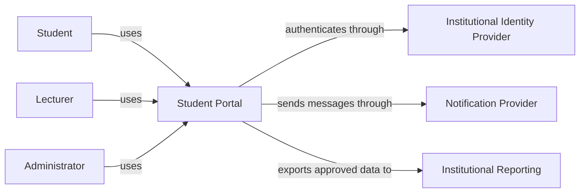

# Case study — Northstar student portal

## Your role

You are a junior architecture team supporting Northstar University College. The
college wants to replace several disconnected tools with one student portal.
Your job is to propose and explain an architecture. Product names are not the
starting point: begin with needs, risks, and constraints.

## Users and capabilities

| Actor | Main capabilities |
| --- | --- |
| Student | Sign in, view personal results, upload assignments, read notifications |
| Lecturer | Publish results, review assigned submissions, post course notifications |
| Administrator | Manage academic periods, correct authorised records, view audit history |
| Identity team | Operate the existing institutional identity provider |
| Service desk | Diagnose incidents without unrestricted access to academic data |

## Scale and traffic assumptions

- 5,000 enrolled students and 200 employees.
- Normal load is moderate, but result publication creates a sharp login and read
  peak.
- Assignment deadlines create large concurrent uploads.
- Most requests come from Belgium, but students may connect from abroad.
- The architecture is operated by a small IT team; operational simplicity
  matters.

These are design assumptions, not measured facts. Mark them as assumptions in
your work and identify which measurements would validate them.

## Functional requirements

The first release must support:

1. institutional single sign-on;
2. viewing results for the signed-in student;
3. lecturer publication of authorised results;
4. assignment upload with malware scanning;
5. notification creation and delivery;
6. an administrative correction workflow; and
7. an audit trail for sensitive changes.

## Quality attributes and constraints

| Area | Initial requirement or constraint |
| --- | --- |
| Security | A user must never gain access to another student's results through identifier manipulation. |
| Privacy | Personal and academic data must be protected in transit, at rest where appropriate, and in logs. |
| Availability | Result viewing should remain available during publication peaks, except during an agreed maintenance window. |
| Recovery | The team must define and test recovery objectives for academic records and uploaded work. |
| Performance | Common pages should respond quickly under expected peak load; the team must agree on a measurable target. |
| Maintainability | A small team must be able to deploy, observe, and recover the service. |
| Cost | The design must fit a realistic education-sector operating budget. |
| Integration | The existing identity provider remains the source of institutional identities. |

The wording deliberately leaves several targets unquantified. Part of
architecture work is turning phrases such as “quickly” and “available” into
testable scenarios with stakeholders.

## Initial external context

This is a context view. It intentionally does not decide whether the portal is
a monolith, a set of services, a container platform, or a managed application.

## Rules for all labs

- State assumptions instead of silently inventing facts.
- Use fictional data only.
- Connect every major component to at least one requirement.
- Record at least one disadvantage for every significant choice.
- Treat all AI-generated output as an unverified proposal.
- Do not add complexity merely because a technology is familiar or popular.
