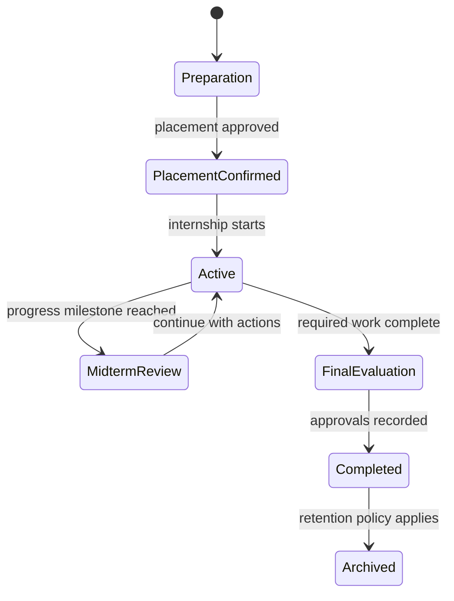
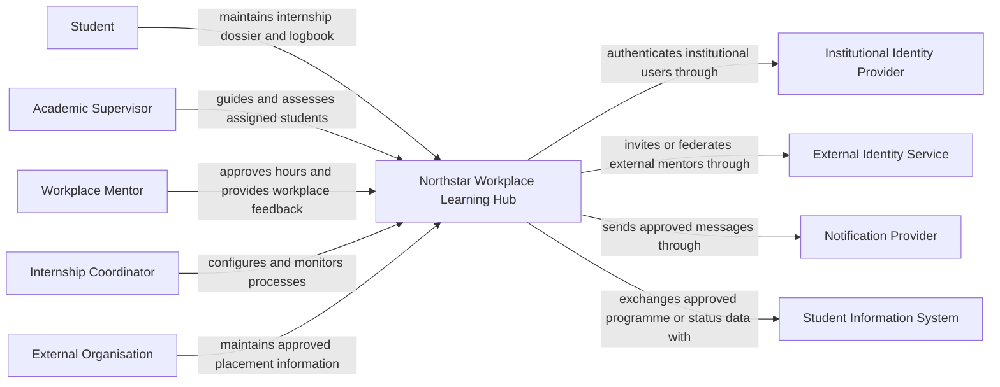

# Case study — Northstar Workplace Learning Hub

## Domain context

Northstar University College wants one platform for managing workplace learning
from preparation to completion. Students, academic supervisors, workplace
mentors, internship coordinators, and external organisations must collaborate on
one internship dossier without sharing more information than each role needs.

The domain is inspired by the integrated internship, guidance, assessment, and
document-management capabilities described publicly by
[OnStage](https://www.onstagesoftware.com/en). Northstar Workplace Learning Hub
is a fictional teaching case. It does not reproduce the OnStage interface,
branding, proprietary implementation, or real user data.

## Your role

You are a junior architecture team supporting Northstar University College. The
college currently uses email, spreadsheets, shared folders, and separate forms.
Your job is to propose, implement, and defend a coherent platform architecture.
Begin with user journeys, responsibilities, privacy, and risk rather than a
preferred cloud product.

## Actors and responsibilities

| Actor | Main capabilities |
| --- | --- |
| Student | View the assigned placement and phase, maintain a logbook, upload documents, request reviews, read feedback, and monitor progress |
| Academic supervisor | View assigned students, plan guidance moments, review progress and documents, provide feedback, and record an academic assessment |
| Workplace mentor | View only assigned interns, validate workplace hours and logbook entries, provide workplace feedback, and participate in evaluations |
| Internship coordinator | Manage process templates, phases, placements, role assignments, deadlines, exceptions, and completion |
| Organisation contact | Maintain approved organisation and workplace information within an agreed scope |
| Service desk | Diagnose access and workflow incidents without unrestricted access to internship content |
| Identity team | Operate institutional identity and approved access for external mentors |

## Scale and traffic assumptions

- 5,000 active students, 250 academic supervisors, and up to 2,000 external
  workplace mentors.
- Normal traffic is moderate, but phase deadlines and evaluation periods create
  short peaks in logbook submission, document upload, review, and dashboard use.
- External mentors connect from unmanaged networks and may use a personal or
  federated professional identity approved by the institution.
- The platform contains personal data, workplace contact details, feedback,
  attendance or hour records, assessments, and potentially sensitive attachments.
- A small institutional team operates the service; operational simplicity matters.

These are design assumptions, not measured facts. Mark them as assumptions and
identify which measurements or stakeholder decisions would validate them.

## Internship lifecycle

Each programme may configure different activities, but the architecture must
preserve ownership, history, authorization, and auditability across transitions.

## Core functional requirements

The first release must support:

1. institutional sign-in for students and employees plus an approved external
   mentor access flow;
2. an internship dossier linking student, programme, placement, organisation,
   supervisors, dates, phase, and status;
3. role-scoped dashboards for assigned dossiers and required actions;
4. configurable phase activities such as planning, progress, and final
   evaluation meetings;
5. logbook and hour entries submitted by students and approved or returned by
   the assigned workplace mentor;
6. document upload, review status, feedback, version history, and controlled download;
7. formative feedback and final assessment by authorised reviewers;
8. notifications and communication linked to the dossier;
9. exception handling for changed placements, absent mentors, missed deadlines,
   and reassignment; and
10. audit history, retention, archive, and controlled deletion.

## Quality attributes and constraints

| Area | Initial requirement or constraint |
| --- | --- |
| Authorization | A user must access only dossiers, activities, documents, and reviews allowed by their current role and assignment. |
| Privacy | Personal, workplace, feedback, and assessment data must be minimised and protected in transit, storage, logs, exports, screenshots, and lower environments. |
| Integrity | Hours, approvals, feedback, assessment, and phase transitions need clear ownership, version history, and audit evidence. |
| Availability | Core dossier and logbook work should remain available during deadline and evaluation peaks, except during agreed maintenance. |
| Recovery | The team must define and test recovery objectives for dossier records, logbooks, reviews, and uploaded documents. |
| Performance | Assigned-student dashboards and common dossier actions should meet measurable targets under expected peak load. |
| Maintainability | A small team must be able to deploy, observe, support, and recover the service. |
| External access | Workplace mentors must use the cloud service over HTTPS without gaining broad institutional access. |
| Integration | Institutional identity remains authoritative for students and employees; later integrations may exchange programme or placement data. |
| Cost | The design must fit a realistic education-sector operating budget. |

The wording deliberately leaves several targets unquantified. Architecture work
turns words such as “available,” “timely,” and “only assigned dossiers” into
testable scenarios with stakeholders.

## Initial external context

This context view intentionally does not decide whether the Hub is a monolith, a
set of services, a container platform, or a managed application.

## Core data groups

| Data group | Examples | Primary concern |
| --- | --- | --- |
| Identity and role assignment | user ID, institutional role, dossier assignment | least privilege and lifecycle |
| Placement dossier | organisation, workplace, dates, phase, supervisors | correctness and scoped visibility |
| Logbook and hours | date, duration, activity, reflection, approval | integrity and dispute history |
| Documents | agreements, plans, evidence, reviews, versions | malware, access, retention, sensitive content |
| Guidance and reviews | appointments, feedback, actions, assessments | confidentiality and auditability |
| Communication | notifications and dossier-linked messages | privacy, retention, recipient correctness |
| Operational evidence | logs, metrics, traces, audit events | diagnostic value without content leakage |

## Privacy rule for course material

Use fictional names, organisations, contact details, dossiers, and documents.
Screenshots from real systems can expose personal data, workplace information,
progress, or assessment details and must not be committed or submitted unless
explicitly authorised and fully redacted. Cropping a screenshot does not prove
that hidden metadata or visible context is safe.

## Rules for all labs

- State assumptions instead of silently inventing facts.
- Use synthetic identities and data only.
- Connect every major component to at least one requirement.
- Enforce access from current role and dossier assignment, not only a role name.
- Record at least one disadvantage for every significant choice.
- Treat AI-generated output as an unverified proposal.
- Do not copy a commercial interface or add complexity merely because a
  technology is familiar or popular.
