# Foundation — From idea to secure implementation

**Estimated study time:** 90 minutes plus the foundation lab

## Learning objectives

After this module, you can:

- turn an idea into a problem statement, outcomes, scope, and assumptions;
- use simple wireframes and mock-ups to clarify role-specific journeys;
- distinguish epics, features, user stories, acceptance criteria, and technical work;
- include quality attributes, privacy, and cybersecurity in the backlog;
- explain DTAP environments and safe promotion between them;
- describe a secure software delivery lifecycle with automated and human checks; and
- connect implementation, release, operations, and feedback in one traceable flow.

## Why start before the architecture diagram?

An idea such as “build one workplace learning platform” is too broad to implement. Teams need
to understand whose problem they are solving, what successful outcomes look like,
which risks matter, and what can be delivered safely. Architecture translates
that understanding into boundaries and decisions. Delivery turns those decisions
into tested, deployable changes. Operations provides evidence that the result
actually works.

Use this lifecycle as a guide, not a rigid one-way process:

```mermaid
flowchart LR
    Idea --> Discover[Discover problem and stakeholders]
    Discover --> Define[Define outcomes and requirements]
    Define --> Design[Architecture and threat modelling]
    Design --> Plan[Prioritised backlog]
    Plan --> Build[Build and review]
    Build --> Verify[Test security and acceptance]
    Verify --> Release[Release through DTAP]
    Release --> Operate[Observe support and recover]
    Operate --> Learn[Measure and learn]
    Learn --> Discover
```



Feedback can change earlier decisions. Discovering that workplace mentors review
logbooks mainly from mobile devices may change the interaction and API design. A security test can reveal
that a user story or authorization rule was incomplete.

## Step 1 — Frame the problem

Start with a problem statement, not a preferred product:

> Students, academic supervisors, workplace mentors, and internship coordinators
> use disconnected email, spreadsheets, folders, and forms. This creates
> inconsistent access, duplicated work, missed deadlines, and weak progress
> visibility. We need one coherent service that protects internship data and
> can be operated by the existing team.

Capture:

- affected users and stakeholders;
- current journey and pain points;
- desired outcomes and how they will be measured;
- what is explicitly in and out of scope;
- legal, policy, budget, time, and integration constraints;
- known risks and assumptions; and
- the owner who can make scope and risk decisions.

An outcome is not the same as an output. “Deploy a portal” is an output. “Reduce
the time required to submit and approve a logbook entry while preventing access
to unassigned dossiers” describes an outcome that can be measured.

## Step 2 — Understand stakeholders and journeys

A stakeholder affects or is affected by the system. Users are stakeholders, but
security, privacy, service desk, operations, finance, legal, and integration
owners may have requirements that are invisible in the happy path.

Use a simple journey:

```text
Trigger -> user goal -> steps -> decisions -> result -> failure or support path
```

For document upload and logbook review, include missed deadlines, duplicate
actions, changed supervisor assignments, interrupted networks, malware
rejection, accessibility, and support. Architecture based only
on the ideal journey usually fails at boundaries and exception handling.

## Step 3 — Explore journeys with wireframes and mock-ups

Before implementing a frontend, make the workflow visible. A rough visual is
cheap to change and helps users find missing information, actions, states, and
privacy problems.

| Artefact | Purpose | Typical detail |
| --- | --- | --- |
| Sketch | Capture an early idea quickly | Hand-drawn boxes, notes, arrows |
| Wireframe | Show structure, hierarchy, actions, and states | Low-fidelity layout without final colours or branding |
| Mock-up | Show the intended visual appearance | Typography, spacing, colour, realistic content |
| Prototype | Let users try part of the interaction | Clickable or coded transitions using test data |

A wireframe is not the architecture and is not proof that the workflow works.
It is a conversation tool that connects user needs to frontend states, backend
operations, authorization, and data.

### Start with one role and one question

For the workplace learning case, begin with the student question:

> What must I do next, and what is waiting for review?

A simple text wireframe is enough:

```text
+------------------------------------------------------------------+
| Workplace Learning Hub                    [Student] [Sign out]    |
+------------------------------------------------------------------+
| Placement: Example Organisation     Phase: Active     42%        |
| Academic supervisor: A. Example     Workplace mentor: W. Example |
+------------------------------------------------------------------+
| Next actions                                                     |
| [!] Submit week 4 logbook                         Due Friday      |
| [ ] Upload progress document                      Due 15 Nov      |
+------------------------------------------------------------------+
| Recent feedback                                                  |
| Logbook week 3 — Approved by workplace mentor                    |
+------------------------------------------------------------------+
```

The purpose is not visual polish. Reviewers can ask:

- Can the student understand the current phase and next action?
- Which data is necessary on the overview?
- Does the screen reveal feedback or contact data to the wrong role?
- What happens when there is no placement, an overdue action, or a service error?
- Which API calls and authorization checks are implied?

### Draw states, not only the happy path

Create variants for:

- loading;
- no dossier or no assigned students;
- permission denied;
- validation error;
- document scanning or review pending;
- changes requested;
- dependency unavailable; and
- completed or archived dossier.

For a workplace mentor, show only assigned interns and permitted actions. For an
academic supervisor, show review workload and progress signals without exposing
unnecessary private workplace or student data. For a coordinator, make high-risk
actions such as reassignment explicit and confirmable.

### Connect the wireframe to implementation

Annotate each visible element:

| Wireframe element | User story or requirement | API or data need | Security question |
| --- | --- | --- | --- |
| Current phase | Student understands progress | `GET /api/me/dossier` | May this identity see this dossier? |
| Submit logbook | Student records workplace activity | `POST /api/dossiers/{id}/logbook` | Is the student assigned and is the phase open? |
| Approve entry | Mentor validates hours | `POST /api/logbook/{id}/review` | Is this mentor currently assigned? |

Use fictional content. Do not paste screenshots containing real student names,
contact details, organisations, progress, feedback, or assessment information.
Do not copy a commercial product screen; design from the requirements and users.

## Step 4 — From epic to user story

Backlog items exist at different levels:

| Level                     | Purpose                                             | Example                                                                                                     |
| ------------------------- | --------------------------------------------------- | ----------------------------------------------------------------------------------------------------------- |
| Epic                      | Large outcome spanning several increments           | Transparent internship guidance                                                                             |
| Feature                   | Coherent capability within an epic                  | Submit and review weekly logbook entries                                                                    |
| User story                | Small, valuable behaviour from a user's perspective | As a workplace mentor, I want to review an assigned student's hours so that progress is confirmed promptly. |
| Enabler or technical item | Technical work needed to deliver or reduce risk     | Add object-storage lifecycle policy and audit events.                                                       |
| Defect                    | Observed behaviour that violates an expectation     | A workplace mentor can retrieve an unassigned student's document by changing the ID.                        |

The common user-story form is:

```text
As a <role>, I want <capability>, so that <value>.
```

The sentence is a conversation starter, not a complete specification. A useful
story is often evaluated with **INVEST**:

- **Independent** enough to plan and deliver;
- **Negotiable** rather than a hidden fixed design;
- **Valuable** to a user or stakeholder;
- **Estimable** with current knowledge;
- **Small** enough for an iteration; and
- **Testable** through clear outcomes.

Security work does not always fit a user persona naturally. Do not force an
awkward story such as “as a hacker.” Use security requirements, abuse cases, or
technical backlog items when they communicate the work more accurately.

## Step 5 — Acceptance criteria and examples

Acceptance criteria define observable conditions for accepting the story. They
cover the happy path, boundaries, failure, and security-relevant behaviour.

Example:

```gherkin
Given student A is authenticated
And dossier 124 belongs to student B
When student A requests dossier 124
Then the platform does not return the dossier
And the denial is recorded without sensitive dossier content
```

Add criteria for:

- authorized and unauthorized roles;
- invalid, missing, oversized, or malicious input;
- duplicate or replayed operations;
- timeouts and dependency failure;
- accessibility and privacy expectations;
- performance under the stated environment; and
- audit and support evidence.

Acceptance criteria are not only user-interface examples. They can describe API,
data, operational, and security outcomes.

## Step 6 — Quality attributes and cybersecurity requirements

User stories describe slices of behaviour. Cross-cutting qualities require
explicit scenarios and engineering work. For every feature, ask:

### Identity and access

- Who initiates the action?
- How is identity established and propagated?
- Which resource and action are authorized?
- What happens when identity or policy is unavailable?

### Data and privacy

- Which data is personal, workplace-related, assessment-related, secret, or public?
- Where is it collected, stored, copied, logged, backed up, and deleted?
- Is every collected field necessary?
- Can production data be excluded from lower environments?

### Threats and misuse

- How could the feature be abused?
- Which trust boundary is crossed?
- What prevents, detects, contains, and recovers from the abuse?
- How will the control be tested?

### Reliability and operations

- What fails when a dependency is slow or unavailable?
- Which timeout, retry, and idempotency rules apply?
- Which metric, log, trace, and alert will support operation?
- How is rollback or recovery performed?

Use threat modelling early enough to change the design. A lightweight method can
combine data-flow diagrams, trust boundaries, abuse cases, and a structured threat
prompt such as spoofing, tampering, repudiation, information disclosure, denial
of service, and elevation of privilege. The method supports thinking; it does not
replace context or verification.

## Step 7 — Prioritise and prepare work

Prioritisation balances value, risk, dependency, learning, and cost. A first
increment should often test the riskiest assumptions and complete a thin
end-to-end path rather than build every layer separately.

Possible ordering for the workplace learning platform:

1. prove sign-in integration in a non-production environment;
2. implement one authorized dossier-read flow with audit evidence;
3. add logbook submission and assigned-mentor approval;
4. add document upload, scanning, and supervisor review; and
5. add coordinator reassignment after its approval and audit rules are agreed.

A **Definition of Ready** is a team agreement for when work is understood enough
to begin. It may require an owner, acceptance examples, dependencies, data
classification, and unresolved risks to be visible. It must not become a heavy
approval barrier that prevents learning.

A **Definition of Done** is a shared quality agreement. For this course, a story
is not done until applicable code review, tests, documentation, security checks,
telemetry, deployment, and acceptance evidence exist. “Works on my machine” is
not done.

## Step 8 — DTAP environments

DTAP stands for **Development, Test, Acceptance, and Production**. Organisations
may use different names or combine stages, but each environment needs a clear
purpose and control boundary.

| Environment | Primary purpose | Data | Access and change |
| --- | --- | --- | --- |
| Development | Rapid implementation and local integration | Synthetic or minimal safe data | Developers can change frequently; no production secrets |
| Test | Automated and exploratory verification | Repeatable synthetic datasets | Changes come through the pipeline; test tools have scoped access |
| Acceptance | Stakeholder validation in production-like conditions | Representative anonymised or synthetic data | Controlled releases and business acceptance |
| Production | Real service and data | Real classified data | Least privilege, approved changes, monitoring, audit, recovery |

DTAP is more than four copies of the application. Separate:

- accounts, credentials, and encryption keys;
- network boundaries and service endpoints;
- configuration and feature flags;
- data sets and retention;
- logging access and alert destinations; and
- release permissions.

Promote the same immutable artefact through environments where practical. Do not
rebuild different code for production. Provide environment-specific configuration
and secrets at deployment. Keep production data out of lower environments unless
an approved, protected, and minimised process makes it necessary.

### Production-like does not mean identical

Acceptance should reproduce the behaviours and constraints needed for confidence,
such as identity flow, network rules, database engine, migration path, and
representative load. It need not duplicate full production scale at all times.
Document differences that could invalidate a test.

## Step 9 — Secure CI/CD

A delivery pipeline creates repeatable evidence and reduces manual drift:

```mermaid
flowchart LR
    Commit --> Review[Peer review]
    Review --> Build[Reproducible build]
    Build --> Unit[Unit and component tests]
    Unit --> Scan[Secret dependency code and IaC checks]
    Scan --> Package[Signed or traceable artefact]
    Package --> Test[Test deployment and integration tests]
    Test --> Accept[Acceptance and security validation]
    Accept --> Approve[Risk-based approval]
    Approve --> Prod[Production deployment]
    Prod --> Verify[Health and security verification]
```



Choose checks according to technology and risk:

- peer review and branch protection;
- unit, integration, contract, and end-to-end tests;
- secret scanning;
- software composition or dependency analysis;
- static application security testing;
- infrastructure-as-code and configuration checks;
- container-image scanning when images are used;
- dynamic security testing against an authorised test environment;
- artefact provenance, inventory, and deployment traceability; and
- manual review for high-impact changes.

A scanner finding is evidence to triage, not an automatic proof of exploitability.
Conversely, a clean scan is not proof of security. Keep threat-informed tests and
human review.

## Step 10 — Release safely

Plan both application and database changes. A rollback can fail if a migration
removed data or old code cannot read the new schema. Prefer compatible, staged
changes when possible.

Release strategies include:

- **rolling deployment:** replace instances gradually;
- **blue-green:** switch traffic between two complete versions;
- **canary:** expose a new version to a small controlled share first; and
- **feature flag:** separate code deployment from feature activation.

Each strategy needs success criteria, observability, an abort decision, and a
tested recovery path. A feature flag adds configuration and cleanup work; it is
not free safety.

## Step 11 — Operate, learn, and improve

After release, compare real outcomes with the original problem and assumptions:

- Are users completing the journey?
- Do authorization denials and abuse signals look expected?
- Are latency and error targets met?
- Are support requests decreasing?
- Can the team restore data and service?
- Which cost or capacity assumption was wrong?

Feed incidents, user research, vulnerability reports, telemetry, and cost data
back into the backlog. Architecture is maintained through decisions and evidence,
not completed once a diagram is approved.

## End-to-end traceability

Use a simple chain:

```text
Problem -> outcome -> story or requirement -> acceptance criteria
-> architecture decision -> code/configuration -> test evidence
-> deployed artefact -> operational signal -> learning
```

Traceability should be lightweight enough to maintain. Link work items, ADRs,
commits, test results, releases, and incidents where they add accountability or
diagnostic value.

## Practice and self-check

1. Rewrite “build a secure cloud portal” as a problem and two measurable outcomes.
2. Draw a low-fidelity student-dashboard wireframe and annotate three API needs and three authorization questions.
3. Write one logbook user story and five acceptance criteria, including two security cases.
4. Explain the difference between a wireframe, mock-up, prototype, acceptance criteria, and Definition of Done.
5. Why should production secrets and data not be copied into Development or Test?
6. Which pipeline checks would you choose for a frontend change, an API change, and an infrastructure change?
7. Give one case where rollback is unsafe and a forward fix is preferable.
8. Identify one operational signal that could invalidate a design assumption.

## Summary

- Start with problems and measurable outcomes, not tools.
- Use low-fidelity wireframes to expose roles, states, data, and actions before coding.
- User stories need acceptance examples; quality and security need explicit scenarios and tests.
- Threat modelling, privacy, and operational design start before implementation.
- DTAP separates purposes, identities, data, configuration, and change authority.
- Secure CI/CD combines repeatable automation, risk-based review, traceability, and verification.
- Release and operations produce feedback that changes the backlog and architecture.

Continue with [Foundation Lab — Shape a secure delivery plan](../hands-on/00-from-idea-to-implementation.md),
then [Module 1 — Systems thinking and architecture](01-systems-thinking.md).
