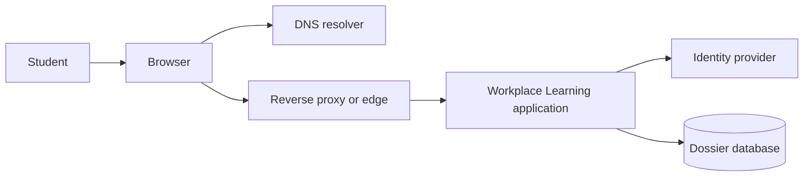

# Module 1 — Systems thinking and architecture

**Estimated study time:** 60 minutes plus Lab 1

## Learning objectives

After this module, you can:

- explain IT architecture in terms of responsibilities, relationships, and decisions;
- distinguish requirements, quality attributes, constraints, and assumptions;
- model a system as an end-to-end chain rather than a set of silos;
- identify dependencies, boundaries, and likely failure impact; and
- explain why every architecture choice creates trade-offs.

## Prerequisites

Read the [workplace learning case](../case-study/workplace-learning-platform.md). No architecture
experience is required.

## What is IT architecture?

IT architecture describes the important parts of a system, what they are
responsible for, how they interact, and why significant choices were made. The
word *important* matters: architecture focuses on decisions that strongly affect
cost, risk, quality, delivery, or future change.

A server inventory is not an architecture. A product list is not an
architecture. A diagram becomes useful only when its elements and relationships
help answer a real question.

Consider these three statements:

- “The platform uses a database.” This names a component.
- “The platform stores internship dossiers, logbooks, and reviews in a relational database.” This adds responsibility.
- “The platform uses a managed relational database because workflow records need
  transactions and the small team cannot operate a database cluster; this adds
  recurring cost and provider dependency.” This communicates a decision and its
  trade-off.

## Four types of design input

| Type | Question | Workplace Learning Hub example |
| --- | --- | --- |
| Functional requirement | What must the system do? | A student submits a logbook entry and the assigned mentor reviews it. |
| Quality attribute | How well must it do it? | Assigned-student dashboards remain responsive during evaluation deadlines. |
| Constraint | What limits the solution space? | The institutional identity provider must remain in use. |
| Assumption | What do we currently believe? | Peak traffic lasts about 30 minutes. |

An assumption is not a requirement. It must be validated. If the peak lasts six
hours rather than 30 minutes, a cost or capacity decision based on that assumption
may fail.

### Turn vague qualities into scenarios

“The platform must be fast” is difficult to test. A quality-attribute scenario is
more useful:

| Part | Example |
| --- | --- |
| Source | Authenticated academic supervisors |
| Stimulus | Request the assigned-student dashboard |
| Environment | Evaluation deadline with concurrent reviews |
| Artefact | Workplace Learning API and dossier store |
| Response | Return only currently assigned dossiers without leaking another student's data |
| Measure | 95% of responses under an agreed threshold at an agreed request rate |

Stakeholders must agree on the numbers. Architects should not invent service
levels without business and operational input.

## From silos to a chain

A student sees one page. The successful action may depend on:

Every component can appear healthy in isolation while the complete journey
fails. DNS can resolve correctly while authorization rejects the request. The
web page can load while the assigned-dossier query times out. The identity
provider can authenticate a workplace mentor while the backend incorrectly
authorizes access to an unassigned student's dossier.

Systems thinking asks:

- What happens before and after this component?
- Which information or identity crosses the boundary?
- What does this component depend on?
- What depends on it?
- How does failure appear to the user?
- Which team owns diagnosis and recovery?

## Responsibilities and boundaries

Give each major component a clear responsibility. “Backend” is too broad if it
means authentication, placement rules, logbook workflows, file processing,
reviews, notifications, and every
data operation without further explanation.

Boundaries matter because they indicate a change in responsibility, technology,
ownership, deployment, trust, or failure behaviour. A boundary is not
automatically bad; it simply creates an interface that must be designed and
operated.

Use a dependency table before drawing a detailed diagram:

| Component | Responsibility | Depends on | User-visible failure |
| --- | --- | --- | --- |
| Identity provider | Establish institutional identity | Directory and login policy | Sign-in fails |
| Workplace Learning application | Enforce workflow and authorization rules | Identity, database, storage | Page or action fails |
| Dossier database | Persist placement, logbook, phase, and review records | Storage and database service | Progress or approvals unavailable or stale |

## Trade-offs, not universal best practices

A modular monolith may suit a small team because it is simple to deploy and
debug. Microservices may permit independent deployment and scaling, but add
network calls, versioned interfaces, distributed failure modes, telemetry
needs, and operational work. Neither style is automatically superior.

Use a trade-off statement:

> We choose **X** because **drivers**. This improves **benefits**, but introduces
> **costs and risks**. We will revisit the decision when **measurable condition**.

Example:

> We start with a modular monolith because one small team owns the Workplace Learning Hub and
> expected scale is moderate. This simplifies deployment and debugging, but
> modules cannot be scaled independently. We will reconsider separation if
> measurements show one workload dominates capacity or release coupling blocks
> delivery.

## Common mistakes

- Starting with a fashionable technology rather than a problem.
- Treating every stakeholder request as equally important without resolving conflicts.
- Drawing components without responsibilities or labelled relationships.
- Hiding uncertainty instead of recording assumptions.
- Calling a benefit a trade-off while ignoring its cost.
- Optimising one component while making the end-to-end journey worse.

## Practice and self-check

1. Classify each statement as functional requirement, quality attribute,
   constraint, or assumption: “use the existing identity provider”; “students
   upload PDF files”; “the service is easy to recover”; “peak load is 600
   requests per second.”
2. Name six components that may participate when a workplace mentor reviews a logbook entry.
3. For each component, identify one dependency and one failure symptom.
4. Explain why “deploy three load balancers” is not a requirement.
5. Write one measurable quality scenario for document upload and review.

## Summary

- Architecture connects needs, responsibilities, relationships, decisions, and consequences.
- Functional requirements describe behaviour; quality attributes describe how well it must work.
- Constraints limit choices; assumptions need validation.
- End-to-end reasoning exposes dependencies that silo thinking misses.
- A justified decision includes disadvantages and a condition for review.

Continue with [Lab 1 — Map the system](../hands-on/01-map-the-system.md).
