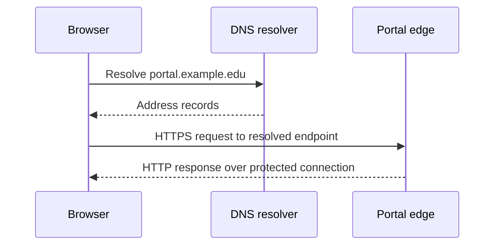
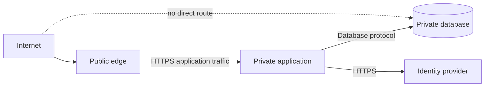

# Module 2 — Networks and communication

**Estimated study time:** 60 minutes plus Lab 2

## Learning objectives

After this module, you can:

- trace a typical HTTPS request from a browser to an application;
- explain the distinct roles of DNS, IP, transport, TLS, and HTTP;
- describe reverse proxies, load balancers, and network segmentation;
- separate reachability evidence from application-correctness evidence; and
- form testable hypotheses for common network and web failures.

## Prerequisites

Complete [Module 1](01-systems-thinking.md). Basic familiarity with IP addresses
and web browsers is helpful.

## One request uses several protocols

When a student opens `https://portal.example.edu/results`, the browser may:

1. parse the URL and check local state or caches;
2. ask a resolver for addresses associated with the host name;
3. route packets to an address across one or more networks;
4. establish a transport connection or session;
5. negotiate protected communication for HTTPS;
6. send an HTTP request; and
7. receive and process an HTTP response.

The exact sequence varies by cache state, HTTP version, network, proxying, and
browser implementation. Architecture diagrams should show the level of detail
needed for the question, not pretend every request follows one identical path.

## Protocol responsibilities

| Layer or protocol | Main responsibility | What success does not prove |
| --- | --- | --- |
| DNS | Resolve names to records such as addresses | The application is healthy or the address is authorised |
| IP | Address and route packets | A service is listening or data is protected |
| TCP | Reliable ordered byte stream | Application requests are valid |
| UDP | Datagram transport | Reliability unless a higher protocol provides it |
| QUIC | Secure multiplexed transport over UDP | Application authorization is correct |
| TLS | Confidentiality, integrity, and peer authentication as configured | The signed-in user may access a specific result |
| HTTP | Request and response semantics | The business operation is correct |

HTTP/1.1 and HTTP/2 commonly use TCP; HTTP/3 uses QUIC over UDP. Avoid teaching
“HTTPS always means TCP port 443” as an absolute architecture law. Port 443 is
the default for an HTTPS URI, while implementations and intermediaries can use
different internal paths.

## DNS is resolution, not an in-path proxy

A simplified diagram often places DNS before the server:

After resolution, application traffic normally goes to the resolved endpoint,
not through the DNS resolver. Keeping this distinction prevents misleading
failure analysis.

## Reverse proxies and load balancers

A reverse proxy accepts requests on behalf of backend services. Depending on
the design, it may:

- terminate TLS;
- route by host name or path;
- enforce request-size or rate limits;
- attach or forward request metadata;
- perform health checks; and
- direct traffic to one or more application instances.

A load balancer distributes eligible traffic. It cannot repair a slow query,
an incorrect authorization rule, or an exhausted database connection limit.
Health checks must test something meaningful: a process that returns `200 OK`
while all dependencies are unusable may be alive but not ready.

### Forwarded identity and client information

After TLS termination, the application may depend on headers added by a trusted
proxy. The application must not blindly trust the same headers from any client.
Document which intermediary is trusted to set them and how untrusted values are
removed or overwritten.

## Network segmentation

The public frontend does not need unrestricted access to every data store.
Network controls can restrict communication to required paths:

Segmentation reduces reachable attack surface and limits incident impact, but it
does not replace application authorization. A compromised application with
legitimate database access can still misuse that access.

## Interpreting evidence

| Observation | Supported conclusion | Not yet proven |
| --- | --- | --- |
| DNS returns an address | The resolver produced a record | The address serves the correct application |
| TCP connection succeeds | Something accepted the connection | TLS and HTTP will succeed |
| TLS handshake succeeds | A protected session was negotiated | The application or user authorization works |
| HTTP `200` from `/health` | That endpoint returned success | All user journeys work |
| HTTP `401` | Credentials are absent or unacceptable in this context | The user lacks permission |
| HTTP `403` | The server refuses the action | The identity is invalid |
| HTTP `500` | Server-side processing failed | The database is definitely the cause |

Status-code meaning comes from HTTP semantics, but an application's error
handling can still be misleading. Combine the response with logs, traces, and
dependency metrics.

## A diagnostic sequence

Start broad and move inward:

1. Confirm the exact user journey, time, and scope.
2. Test name resolution from an affected location.
3. Test connection and TLS establishment.
4. Inspect the HTTP status, headers, and timing.
5. Follow a correlation identifier into application telemetry.
6. Test dependencies from the application's network context.
7. Compare findings with a healthy request.

Do not jump directly from “the site is slow” to “add capacity.” Form competing
hypotheses and choose a test that distinguishes them.

## Practice and self-check

1. Draw the path from browser to database and label at least three protocols.
2. Explain why a successful DNS lookup does not prove the portal is available.
3. Why should the results database normally not be public?
4. A login page loads, but submitting it times out. Name three possible failure
   locations and an observation that would separate them.
5. Explain the difference between a reverse proxy and the application behind it.

## Summary

- DNS resolves names; it is not normally a hop in the application-data path.
- TLS, HTTP, authentication, and authorization provide different guarantees.
- Proxies and load balancers route traffic but do not fix backend logic or data bottlenecks.
- Network segmentation limits allowed paths and must be combined with identity and application controls.
- Each test proves only part of the end-to-end journey.

Continue with [Lab 2 — Trace a web request](../hands-on/02-trace-a-web-request.md).
