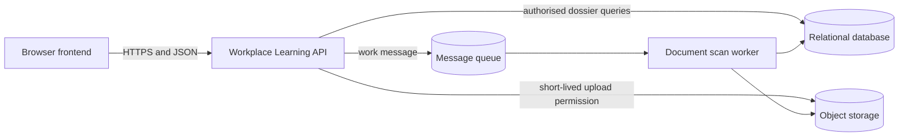

# Module 3 — Applications, APIs, and data

**Estimated study time:** 60 minutes plus Lab 3

## Learning objectives

After this module, you can:

- separate presentation, business logic, integration, and persistence responsibilities;
- model a request across frontend, backend, API, and data stores;
- choose an appropriate role for relational data, object storage, cache, and queues;
- compare synchronous and asynchronous processing; and
- identify consistency, retry, and authorization concerns in application flows.

## Prerequisites

Complete [Module 2](02-networks-and-communication.md).

## Responsibilities in an application

The frontend presents information and captures user intent. The backend enforces
business rules, validates requests, applies authorization, and coordinates data
and integrations. An API defines how software parts communicate. A data store
persists or serves information for a specific purpose.

These are logical responsibilities. A small application can package them in one
deployable unit without losing the conceptual separation.

## APIs are contracts

An API contract defines more than a URL. It includes:

- request and response structure;
- identity and authorization expectations;
- validation rules;
- error semantics;
- compatibility and versioning expectations;
- timeouts and size limits; and
- retry or idempotency behaviour.

For example, `GET /api/dossiers/123` is unsafe if `123` alone decides which
internship dossier to return. The backend must connect the authenticated subject,
current role, dossier assignment, requested action, and resource state. Hiding
or disabling a frontend control is only user experience; it is not server-side authorization.

### Useful HTTP distinctions

- `401 Unauthorized` normally indicates missing or unacceptable authentication
  credentials, despite the historical name.
- `403 Forbidden` indicates that the server understood the request but refuses
  it.
- `404 Not Found` may be used to avoid revealing whether a protected object exists.
- `409 Conflict` can communicate a conflict with current resource state.
- `429 Too Many Requests` communicates rate limiting.

The API specification should state the application's intended use. Do not force
clients to guess from inconsistent errors.

## Put data in a store that matches its use

| Store | Good fit | Main design concerns |
| --- | --- | --- |
| Relational database | Structured records, relationships, constraints, transactions | Schema evolution, query design, connections, backup and recovery |
| Object storage | Large binary objects such as agreements, plans, and evidence documents | Access policy, metadata, retention, malware scanning, lifecycle |
| Cache | Repeated reads where temporary copies are acceptable | Staleness, invalidation, key design, sensitive data |
| Message queue | Decoupled work and burst absorption | Duplicate delivery, ordering, retries, poison messages, monitoring |

A cache is not automatically the source of truth. If a dossier phase or review changes, the
system needs a policy for updating or expiring cached copies. A queue is not a
magic reliability layer: messages can be delayed, delivered more than once, or
fail repeatedly.

## Synchronous and asynchronous work

In synchronous work, the caller waits for completion. This is appropriate when
the result is quick and needed immediately. Long or bursty work can be moved to
an asynchronous process.

### Internship document upload example

1. The student requests permission to upload a document for a required dossier activity.
2. The backend authenticates the student, checks the current dossier assignment,
   phase, activity, deadline, and permitted document type, then creates an upload
   record and returns a short-lived permission.
3. The browser uploads the file to object storage.
4. The system emits a scan request.
5. A worker retrieves and scans the file.
6. The worker records `accepted` or `rejected` status.
7. The frontend polls or receives an event and shows the scan state; only an
   accepted document becomes available to the assigned reviewer.

The upload request returns before scanning finishes. The user needs an explicit
state such as `uploaded`, `scanning`, `accepted`, or `rejected`; “success” must
not incorrectly imply that every background step completed.

## Retries and idempotency

A timeout does not prove that an operation failed. The server may have completed
the action while the response was lost. Retrying a non-idempotent operation can
create duplicate logbook entries, document versions, reviews, or notifications.

Use techniques such as:

- a client-generated idempotency key;
- a unique business constraint;
- processing-state records;
- deduplication; and
- retry limits with a dead-letter or review path.

Each technique has scope and retention rules. “Exactly once” is often an
end-to-end business property built from several mechanisms, not a property to
assume from one messaging product.

## Data ownership and consistency

Declare which component owns a record and which copies are derived. If both the
platform and an institutional system can independently edit the same placement or phase,
conflicts and unclear accountability follow.

Ask:

- What is the authoritative source?
- Which operation requires a transaction?
- How fresh must each read be?
- What happens when an integration is unavailable?
- How are schema and contract changes coordinated?
- Which records must be retained or deleted?

## Practice and self-check

1. Describe the data flow for an assigned workplace mentor reviewing a logbook entry.
2. Choose a store for dossier records, uploaded evidence documents, repeated
   programme instructions, and scan jobs. Explain each choice.
3. Explain why client-side validation is useful but insufficient.
4. Name three new failure modes introduced by asynchronous document scanning.
5. Design an idempotency approach for a “submit logbook week” action.

## Summary

- Frontends present; backends enforce rules; APIs define software contracts.
- Server-side authorization must protect every sensitive object and action.
- Select data stores by access pattern, consistency, size, and operational needs.
- Asynchronous work improves responsiveness and burst handling but adds states and failure modes.
- Retries require idempotency and observable processing state.

Continue with [Lab 3 — Model an application flow](../hands-on/03-model-an-application-flow.md).
