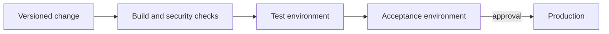

# Module 4 — Infrastructure, cloud, and delivery

**Estimated study time:** 60 minutes plus Lab 4

## Learning objectives

After this module, you can:

- compare physical servers, virtual machines, containers, and managed platforms;
- explain infrastructure, platform, and software service boundaries;
- identify responsibilities that remain with the customer in managed services;
- design separate development, test, acceptance, and production environments; and
- include deployment, cost, and operational capability in architecture decisions.

## Prerequisites

Complete [Module 3](03-applications-apis-and-data.md).

## Execution models

| Model | You package or manage | Useful when | Watch for |
| --- | --- | --- | --- |
| Physical server | Hardware, OS, runtime, application | Special hardware, strict locality, existing capability | Procurement time, utilisation, hardware failure |
| Virtual machine | Guest OS, runtime, application | OS control and familiar operations are needed | Patching, image drift, capacity, recovery |
| Container | Application and dependencies in an image | Repeatable packaging and fast deployment help | Host/orchestrator operations, image security, state |
| Managed application platform | Application and configuration | Small teams value reduced platform work | Platform limits, cost model, portability |
| Function service | Event-driven function code and configuration | Short, stateless, bursty work fits | Limits, cold starts, integration complexity |

A container normally shares the host kernel; a virtual machine has a guest
operating system. Containers are not “lightweight VMs,” and neither packaging
model decides the complete architecture.

## IaaS, PaaS, and SaaS

- **Infrastructure as a Service** provides programmable compute, storage, and
  networking. The customer still manages much of the operating system and
  application stack.
- **Platform as a Service** manages more of the runtime and deployment platform.
  The customer focuses more on application code, data, identity, and configuration.
- **Software as a Service** provides an application capability. The customer
  still manages users, configuration, data use, integrations, and governance.

Service labels are broad. Read the actual responsibility boundary and service
contract rather than assuming a label guarantees security, backups, or
availability.

## Shared responsibility

Moving to a managed database can transfer tasks such as hardware replacement and
database-engine patching to a provider. It does not transfer responsibility for:

- selecting appropriate access controls;
- protecting credentials;
- designing schemas and queries;
- choosing backup retention and recovery objectives;
- validating restore procedures;
- classifying and deleting data; or
- monitoring the application's use of the database.

“Managed” changes who performs work; it does not remove the work or the need to
verify outcomes.

## Orchestration is a trade-off

Container orchestration can automate placement, service discovery, health-based
replacement, rollout, and scaling. It also introduces control-plane knowledge,
networking, policies, observability, upgrades, and incident procedures.

For one workplace learning platform owned by a small team, a managed application platform may be the
simpler choice. If the organisation already operates a reliable container
platform for many teams, using it may be reasonable. Capability and total
portfolio context change the decision.

## Environments and delivery

Separate environments reduce the chance that testing changes real data or
interrupts real users.

Use the same artefact through the pipeline where possible; inject
environment-specific configuration at deployment. Keep production secrets out
of source code, images, test data, and logs.

Delivery design includes:

- automated tests and policy checks;
- reproducible builds;
- migration sequencing;
- rollback or forward-fix strategy;
- deployment health signals;
- approvals appropriate to risk; and
- auditability of who deployed what and when.

## Stateless and stateful design

Stateless application instances are easier to replace or scale because durable
session and business data live elsewhere. This does not mean the system is
stateless: the state has moved to databases, object stores, caches, or tokens.

Document where state lives. A container restart must not silently lose an
accepted logbook entry, document, or review. Local disk may be appropriate for temporary processing,
but the lifecycle and recovery consequence must be explicit.

## Cost is an architecture quality

Compute is only one cost. Include:

- database and object storage;
- backups and replicas;
- outbound network traffic;
- logs, metrics, and traces;
- security and support plans;
- build and test environments;
- software licences; and
- engineering and on-call time.

A more complex platform can reduce one infrastructure cost while increasing
operational labour. Compare total cost under realistic normal and peak usage.

## Option comparison for the Workplace Learning Hub

| Driver | One VM plus managed database | Managed application platform | Orchestrated containers |
| --- | --- | --- | --- |
| Initial simplicity | High | High | Lower without an existing platform |
| OS control | High | Low to medium | Medium to high |
| Scaling automation | Manual or scripted | Usually built in | Flexible but operationally demanding |
| Team learning load | Familiar for many teams | Platform-specific | Significant |
| Portability | Application-dependent | Potential provider coupling | Image portability does not remove platform coupling |

The table does not select a winner. Weights depend on requirements and existing
skills.

## Practice and self-check

1. Compare a VM, container platform, and managed application platform for the Workplace Learning Hub.
2. Name five customer responsibilities that remain with a managed database.
3. Draw a delivery path and show where tests, migration, approval, and rollback occur.
4. List five cost items that a simple deployment diagram may hide.
5. Explain why “containers scale automatically” is incomplete.

## Summary

- Infrastructure choices change control, responsibility, and operational work.
- Managed services reduce selected tasks but never remove customer responsibility.
- Orchestration is valuable when its benefits justify its platform cost.
- Delivery, configuration, secrets, state, and recovery belong in architecture.
- Total cost includes people, telemetry, data movement, and non-production environments.

Continue with [Lab 4 — Compare deployment options](../hands-on/04-compare-deployment-options.md).
