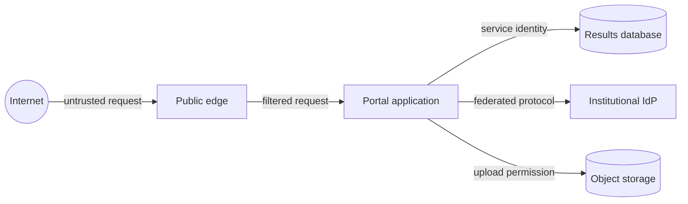

# Module 5 — Identity and security by design

**Estimated study time:** 75 minutes plus Lab 5

## Learning objectives

After this module, you can:

- distinguish authentication, authorization, and accounting or audit;
- identify trust boundaries and sensitive data flows;
- apply least privilege, defence in depth, and secure secret handling;
- describe the role of federation, OpenID Connect, and OAuth without treating
  tokens as automatic proof of access; and
- turn security concerns into testable controls.

## Prerequisites

Complete [Module 4](04-infrastructure-cloud-and-delivery.md).

## Authentication is not authorization

- **Authentication** establishes an identity or verifies a credential.
- **Authorization** decides whether that identity may perform a specific action
  on a specific resource in the current context.
- **Audit** records security-relevant actions so they can be reviewed.

A student who signs in successfully is authenticated. The backend must still
check whether that student may view result `124`. This check belongs at the
server-side enforcement point, not only in the browser.

```text
Identity: student-123
Action: read
Resource: result-124
Context: active enrolment, normal session
Decision: deny unless ownership or delegated permission matches
```

## Federation, OpenID Connect, and OAuth

The portal can delegate sign-in to the institutional identity provider.
OpenID Connect builds an identity layer on OAuth 2.0 and can provide information
about the authenticated subject. OAuth is a framework for delegated
authorization; it is not, by itself, a login protocol.

The portal must validate tokens as required for its role and configuration,
including relevant issuer, audience, signature, time, and flow properties. A
token that is cryptographically valid is not proof that every requested action
is allowed. Application authorization remains necessary.

Do not put access tokens in URLs or logs. Keep token lifetime, storage, renewal,
revocation expectations, and browser threat model explicit.

## Trust boundaries

A trust boundary exists where data or authority moves between different trust
levels, identities, ownership domains, or enforcement contexts.



At each crossing, ask:

- Who or what is the caller?
- Which input is untrusted?
- Which action and data are allowed?
- How is the decision enforced?
- What is logged without exposing secrets or sensitive content?
- What happens when the check cannot complete?

Network location alone should not grant broad trust. NIST's zero-trust guidance
emphasises protecting resources and avoiding implicit trust based solely on
network location or ownership.

## Defence in depth

Layer controls so one failure does not immediately expose critical data:

- the edge limits malformed or abusive traffic;
- the application validates input and enforces object-level authorization;
- service identities receive only required permissions;
- network rules permit only necessary paths;
- data is protected in transit and, where appropriate, at rest;
- audit records reveal sensitive changes;
- backups and recovery procedures protect availability and integrity.

Layers must have clear purposes. Adding three products that enforce the same
weak check is not necessarily stronger than one correct check plus independent
containment and detection.

## Least privilege and service identities

The application should not connect to the database as an all-powerful
administrator. Separate runtime, migration, reporting, and support permissions
where practical. A scan worker needs access to pending uploads, not the full
results table. The service desk needs diagnostic metadata, not unrestricted
academic records.

Privileges also have time and environment dimensions. Temporary administrative
access and separate production identities reduce long-lived exposure.

## Secrets

A secret is information used to prove authority, such as a private key,
password, or API credential. Keep secrets out of:

- source control;
- container images;
- test fixtures copied to public repositories;
- command histories and process arguments where avoidable;
- logs and error messages; and
- architecture diagrams shared beyond the authorised audience.

Use an approved secret-management mechanism, restrict retrieval, rotate secrets,
and design for expiration. Prefer short-lived credentials and workload identity
when the platform supports them.

## Backups, logs, and privacy

Security includes availability and correct recovery. A backup is only useful
when the team can restore the right data within agreed objectives. Protect
backup access and test recovery without overwriting production.

Logs can become a second sensitive database. Record actor, action, target,
outcome, time, and correlation context for important events, but avoid passwords,
tokens, full session data, or unnecessary personal content. Define retention and
access rules.

## Turn threats into controls and tests

| Threat | Control | Verification example |
| --- | --- | --- |
| Student changes an ID to read another result | Server checks subject-to-result permission on every request | Automated test uses two student identities and cross-access attempts |
| Stolen upload URL remains usable | Narrow scope and short expiry | Test after expiry and for a different object key |
| Script injects content into a page | Context-appropriate output handling and content policy | Security test with encoded attack strings |
| Database credential leaks | Managed secret, restricted identity, rotation | Scan repository and rotate a test credential |
| Support logs expose tokens | Structured logging with redaction | Test logger with representative auth failures |

OWASP ASVS is a useful source of verifiable application-security requirements;
select requirements appropriate to the application's risk rather than copying a
checklist without context.

## Practice and self-check

1. Draw the sign-in flow and mark trust boundaries.
2. Explain why a valid identity token does not authorize access to every result.
3. List the minimum permissions for the portal runtime, scan worker, and support role.
4. Create one security test for result access and one for upload permission.
5. Name three places where secrets commonly leak.

## Summary

- Authentication establishes identity; authorization permits a specific action on a resource.
- Trust boundaries require explicit validation and enforcement.
- Defence in depth combines prevention, containment, detection, and recovery.
- Least privilege applies to people, services, environments, data, and time.
- A security control is stronger when it has a concrete verification method.

Continue with [Lab 5 — Threat-model the portal](../hands-on/05-threat-model-the-portal.md).
