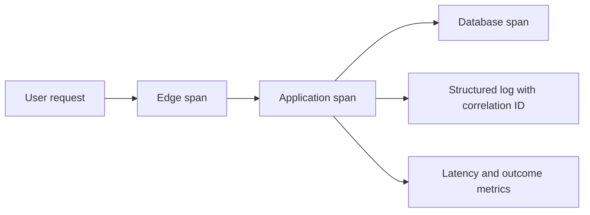

# Module 6 — Scalability, reliability, and observability

**Estimated study time:** 75 minutes plus Lab 6

## Learning objectives

After this module, you can:

- identify single points of failure and cascading-failure risks;
- distinguish availability, resilience, recovery, performance, and scalability;
- explain vertical and horizontal scaling and locate likely bottlenecks;
- define RTO, RPO, service indicators, and useful alerts; and
- combine metrics, logs, and traces during incident diagnosis.

## Prerequisites

Complete [Module 5](05-identity-and-security.md).

## Reliability begins with user journeys

A process being alive is not the same as the service working. Define reliability
for a meaningful operation, such as “an assigned workplace mentor can review a
submitted logbook entry.” Measure successful, authorised completion and latency, not only host
uptime.

### Related terms

| Term | Focus |
| --- | --- |
| Availability | Whether the service can perform its intended function when requested |
| Resilience | Ability to tolerate, contain, or recover from disruption |
| Recoverability | Ability to restore service and data after failure |
| Performance | Resource use and response behaviour under a defined workload |
| Scalability | Ability to handle changed load by adding or changing resources |

## Single points of failure and failure domains

A single point of failure can stop the complete journey. Obvious examples are
one application instance, one database, or one network path. Less obvious
examples include one identity provider, one shared credential, one deployment
pipeline, one region, or one person who knows the recovery procedure.

Redundancy only helps when replicas do not share the same failure. Two
application instances on one failed host do not protect against host failure.
Two database replicas corrupted by the same bad migration do not replace a
recoverable backup.

## RTO and RPO

- **Recovery Time Objective (RTO)** is the targeted maximum time to restore a
  capability after disruption.
- **Recovery Point Objective (RPO)** expresses the targeted maximum tolerable
  data loss measured in time.

An RTO of four hours and RPO of 15 minutes imply different design and test needs
than near-zero targets. Stakeholders set acceptable outcomes; technology teams
show cost and feasibility. Record different objectives for different data if
their business impact differs.

## Scaling does not remove every bottleneck

- **Vertical scaling** increases resources of an existing instance.
- **Horizontal scaling** adds instances.

Horizontal application scaling works best when instances are replaceable and
shared state lives in suitable external stores. It can expose bottlenecks in:

- database connections, locks, indexes, or slow queries;
- external identity or notification rate limits;
- message consumers;
- shared caches;
- network bandwidth; or
- serial business operations.

During an evaluation deadline, adding application instances may create more database
connections and worsen exhaustion. Scale the constrained resource or reduce
load after measuring the actual limit.

## Failure patterns and protections

| Risk | Possible protection | New concern |
| --- | --- | --- |
| Slow dependency consumes all request workers | Timeouts and bounded concurrency | Choosing limits and handling rejection |
| Repeated calls amplify an outage | Limited retries with backoff and jitter | Increased latency and duplicate operations |
| One dependency failure spreads | Circuit breaker or degraded mode | Stale or incomplete experience |
| Traffic burst overloads processing | Queue and rate limit | Delay, backlog, and priority |
| Failed instance receives traffic | Readiness checks and load-balancer removal | Checks can be too shallow or too aggressive |

Retries are not free. Every retry adds load to a struggling dependency. Retry
only operations that are safe, limit attempts, and observe retry volume.

## Service levels and indicators

Choose indicators from user outcomes:

- successful assigned-dossier view rate;
- latency distribution for supervisor-dashboard requests;
- logbook submission and approval rate;
- document scan and review backlog age;
- authentication success rate; and
- notification processing delay.

A Service Level Objective can state a target over a period. Avoid alerting on
every transient deviation. Alert when action is required and include enough
context for the responder to begin diagnosis.

## Metrics, logs, and traces

- **Metrics** aggregate numeric behaviour over time: request rate, error rate,
  latency, CPU, queue depth, database connections.
- **Logs** describe discrete events with context: validation failure, deployment,
  authorization denial, worker exception.
- **Traces** connect timed operations across components for one request or job.

Use correlation identifiers so responders can move from an affected request to
related application, database, and background-processing events. Protect
identifiers and attributes from leaking sensitive data.

Telemetry needs architecture too: collection, buffering, storage, access,
retention, cost, and behaviour during an outage.

## Incident reasoning

Scenario: academic supervisors can sign in, but opening their assigned-student
dashboard returns HTTP `500`. The edge is reachable, identity succeeds, and
database connection usage is at its limit.

Supported conclusions:

- public routing and at least part of TLS and HTTP processing work;
- the identity flow worked for affected users;
- assigned-dossier processing failed server-side; and
- database connection pressure is a strong hypothesis.

Not yet proven:

- connection exhaustion is the only cause;
- the database engine itself is slow;
- increasing the connection limit is safe; or
- adding frontend capacity will help.

Inspect request traces, connection-pool wait time, query latency, active and idle
connections, recent deployments, timeouts, and error logs. Apply a reversible
short-term mitigation, then correct the structural cause and test peak behaviour.

## Practice and self-check

1. Identify three Workplace Learning Hub single points of failure and their failure domains.
2. Propose RTO and RPO questions for dossiers, logbooks, reviews, and uploaded documents.
3. Design a minimal dashboard for an evaluation-deadline peak.
4. Explain how aggressive retries can create a retry storm.
5. List evidence that would distinguish slow queries from connection leakage.

## Summary

- Reliability is defined by successful user outcomes, not process uptime alone.
- Redundancy must cross the failure domain it is meant to survive.
- RTO and RPO are business objectives that drive design and testing.
- Scale the measured bottleneck; more frontend capacity can worsen dependency load.
- Metrics, logs, and traces provide complementary operational evidence.

Continue with [Lab 6 — Diagnose an incident](../hands-on/06-diagnose-an-incident.md).
