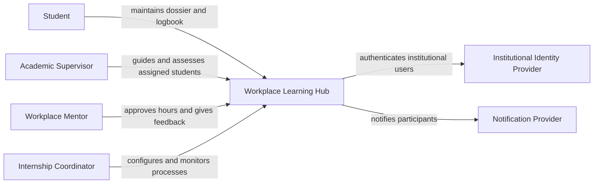
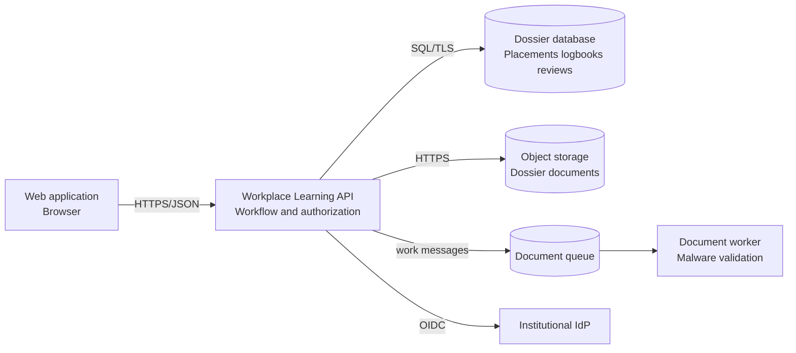
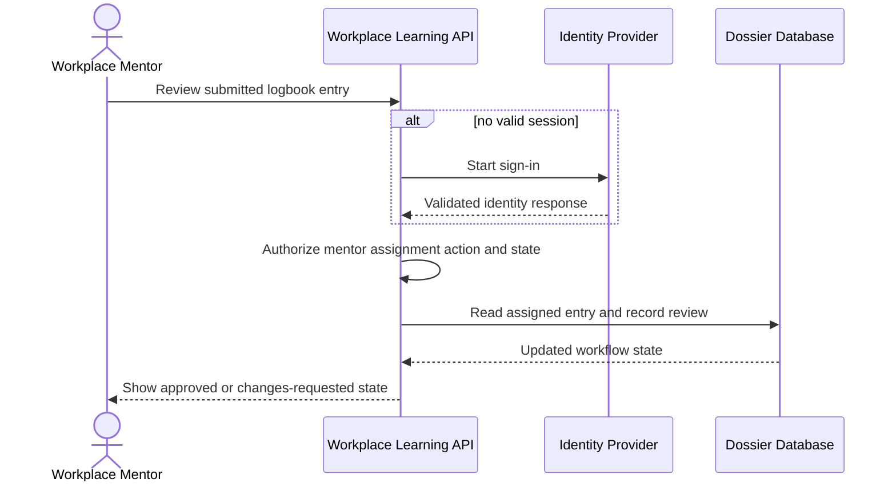

# Module 7 — Architecture views and decisions

**Estimated study time:** 75 minutes plus Lab 7

## Learning objectives

After this module, you can:

- select a diagram type based on audience and question;
- create readable context, container, deployment, and sequence views;
- label relationships with direction, purpose, protocol, and data where useful;
- keep diagrams consistent without forcing all information into one picture; and
- write an Architecture Decision Record with options and consequences.

## Prerequisites

Complete [Module 6](06-reliability-and-observability.md).

## A diagram has an audience and a question

One diagram cannot communicate every aspect of a system. Choose a view that
answers the current question.

| View | Main question | Typical audience |
| --- | --- | --- |
| System context | Who uses the system and which external systems interact with it? | Technical and non-technical stakeholders |
| Container | What are the major runnable or data-holding parts and their responsibilities? | Developers, architects, operations, security |
| Deployment | Where do software instances run in a specific environment? | Operations, infrastructure, security |
| Sequence or dynamic | What happens, in order, for one scenario? | Developers, testers, support, security |

In the C4 model, *container* means a deployable or runnable unit or data store,
not only an operating-system container image. State this when your audience may
misunderstand the term.

## Context view

Keep the Workplace Learning Hub as one system and show people and external systems:



Do not add internal databases or pods to a context diagram. That detail answers a
different question.

## Container view

Show major responsibilities and technology choices only when they clarify the
design:



Every box has a name, type or technology where useful, and responsibility. Every
arrow has a direction and purpose. Avoid labels such as “uses” when a more
specific description is possible.

## Deployment view

A deployment view maps instances to infrastructure for one environment. It can
show zones or failure domains, network boundaries, scaling, and managed services.

Do not mix conceptual and instance counts silently. “Workplace Learning API” in a
container view may map to three production instances and one acceptance instance.
Name the environment and multiplicity.

## Sequence view

A sequence diagram answers one scenario, not the whole product. Include success
and important alternate paths:



If authorization fails, the database query should not return the protected
record. Showing the check in the flow makes the control discussable and testable.

## Diagram quality checklist

- The title states the system, view type, and scope or environment.
- The intended audience and question are known.
- Elements have unique, meaningful names and responsibilities.
- Relationships have directions and useful labels.
- Trust boundaries or ownership boundaries appear when relevant.
- A legend explains colour or notation; colour is not the only signal.
- The view has a date or version and matches related views.
- Unknowns and assumptions are visible in accompanying text.
- Details that do not answer the question are removed.

## Architecture Decision Records

An ADR captures why a significant decision was made. A practical template:

```markdown
# ADR 001 — Use a managed relational database

## Status
Accepted

## Context
What problem, requirements, constraints, and forces drive the decision?

## Decision drivers
- Driver one
- Driver two

## Considered options
1. Option A
2. Option B

## Decision
What is selected and within which scope?

## Consequences
### Positive
- Benefit

### Negative
- Cost or risk

## Validation and review trigger
Which evidence will validate the decision and when should it be revisited?
```

An ADR is not a sales pitch. Include rejected options fairly and record negative
consequences. When a decision changes, supersede the ADR; do not rewrite history.

## Consistency across views

The same element should keep the same name and responsibility. If the container
view shows a queue but the upload sequence bypasses it, either explain the
alternate flow or correct the inconsistency. Trace critical requirements across
views and decisions.

## Practice and self-check

1. Choose a view for a privacy officer, a deployment engineer, and a service-desk responder.
2. Improve the relationship label “Portal uses database.”
3. Draw a failed-upload sequence with a retry-safe path.
4. Explain why a cloud-provider icon cannot replace a responsibility label.
5. Write the negative consequences of choosing a managed database.

## Summary

- Choose views by audience and question.
- Context shows the system in its world; container shows major internal units.
- Deployment maps instances to infrastructure; sequence shows runtime order.
- Clear names, responsibilities, and relationship labels matter more than decoration.
- ADRs preserve context, alternatives, decisions, consequences, and review triggers.

Continue with [Lab 7 — Create views and an ADR](../hands-on/07-create-views-and-an-adr.md).
