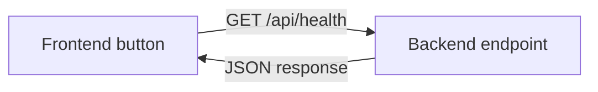

# Implementation journey — From first vertical slice to production

**Estimated study time:** 90 minutes plus incremental project work

## Learning objectives

After this module, you can:

- explain frontend, backend, API, datastore, and pipeline responsibilities to a beginner;
- build functionality in small vertical slices instead of separate technical layers;
- add tests and cybersecurity controls as the system grows;
- promote one traceable artefact through DTAP-like environments; and
- collect implementation evidence for the final architecture defence.

## Start with one vertical slice

A vertical slice crosses the minimum layers needed to deliver one observable
outcome. It is deliberately small.



The first slice can be a status page. It proves that the learner can run two
processes, make an HTTP request, handle success and failure, and explain the
boundary. It does not need authentication, a database, containers, or cloud
deployment on day one.

Avoid building “the whole frontend” and “the whole backend” separately. A thin
end-to-end result reveals integration problems early and gives a stable base for
the next increment.

## Reference project shape

The final project may use any instructor-approved stack, but it must preserve
these responsibilities:

```text
student-portal/
├── frontend/              # Browser UI and client-side tests
├── backend/               # API, business rules, authorization, server tests
├── database/              # Schema, migrations, and safe seed data
├── deployment/            # Local compose, cloud configuration, and IaC
├── docs/                  # Diagrams, ADRs, threat model, runbook
└── .github/workflows/     # Or equivalent CI/CD pipeline definition
```

Use one repository unless a learning objective requires multiple repositories.
A monorepository makes the beginner path, change traceability, and coordinated
testing easier.

## Increment 0 — Prepare the workspace

Goal: every team member can reproduce the local environment.

Deliver:

- repository and branch policy;
- short setup instructions;
- formatter and linter configuration;
- environment-variable example without real secrets;
- health endpoint and simple frontend page; and
- first pipeline that runs formatting and tests.

Security starts here: enable peer review, protect the default branch, exclude
secret files, and use synthetic data.

### Exit evidence

Another learner can clone the repository, follow the instructions, start both
parts, and see the frontend report backend health.

## Increment 1 — Read data end to end

Goal: display a safe list of the signed-in user's fictional results.

Build:

1. a frontend page calls a backend endpoint;
2. the backend validates the request and queries seeded data;
3. the API returns a documented response;
4. the frontend handles loading, success, empty, forbidden, and failure states;
5. tests cover the API contract and data mapping.

For the first classroom increment, the identity can be an instructor-provided
development identity mechanism. Before acceptance, replace it with an approved
framework or identity provider. Never let the production design trust a user ID
sent freely by the browser.

### Exit evidence

- API contract;
- database migration and repeatable seed;
- frontend component or page test;
- backend unit and integration tests; and
- negative test showing student A cannot read student B's result.

## Increment 2 — Write data safely

Goal: implement one validated write, such as creating a draft submission record
or an administrator adding a fictional notification.

Add:

- server-side input validation;
- authorization for the action and resource;
- safe error responses;
- transaction or consistency rules;
- idempotency where retries can duplicate the action; and
- an audit event without sensitive payloads.

The frontend validation improves usability. The backend repeats all security-
relevant validation because a client can be changed or bypassed.

### Exit evidence

Demonstrate valid, invalid, unauthorized, and repeated requests. Show database
state and audit evidence after each case.

## Increment 3 — Run the application in local containers

Goal: run the complete application in a repeatable local Test environment with
separate frontend, backend, and datastore containers.

Add:

- Development and Test configuration;
- one reproducible frontend image and one reproducible backend image;
- a local datastore container with repeatable migrations and synthetic seed data;
- a compose file or equivalent that creates the required network and volumes;
- secret injection through the approved local mechanism;
- health and readiness behaviour; and
- dependency, image, and licence inventory.

If containers are used, run processes as a non-root user where supported, keep
images minimal, pin or control dependencies, avoid copying secrets into layers,
and scan the final image. Containers are a packaging choice, not the architecture itself.

The browser-facing frontend may be published to the host. The backend may be
published for debugging or reached through the frontend proxy. The datastore
must not be exposed beyond the local container network unless a documented test
requires it.

### Exit evidence

Another learner can start the stack with one documented command, execute a
successful and denied request, stop and recreate the containers, and retain only
the data that is intentionally stored in a named volume.

## Increment 4 — Build the secure pipeline

Goal: turn quality and security expectations into repeatable promotion evidence.

The pipeline should include applicable checks:

```text
change -> review -> format/lint -> unit tests -> build
-> secret scan -> dependency scan -> static analysis
-> package -> integration tests -> authorised dynamic tests
-> acceptance -> approval -> deploy -> verify
```

Decide and document:

- which failures block promotion;
- how false positives are triaged;
- who may accept a risk exception and until when;
- how artefacts are versioned and traced to source;
- which credentials each job receives; and
- how untrusted pull-request code is prevented from reaching protected secrets.

Security tooling is risk-based. A frontend package, backend service, container,
and infrastructure definition require different checks. A green pipeline is
evidence of completed checks, not proof that the system is secure.

### Exit evidence

Show one intentionally failing quality test and one harmless security-test
fixture being detected, then remove the fixture and demonstrate a passing pipeline.

## Increment 5 — Promote through DTAP and deploy to cloud

Goal: demonstrate controlled delivery from the local container test stack to an
instructor-approved cloud environment that authorised people can access externally.

- **Development:** rapid local work with synthetic identities and data.
- **Test:** automated integration, contract, negative, and migration tests.
- **Acceptance:** stakeholder journey and approved security validation in a
  production-like configuration.
- **Production:** optional in a classroom; if used, contains fictional data only
  and follows controlled change, monitoring, and recovery.

Build each application image once, scan it, push it to an approved registry, and
deploy the same immutable version or digest to the cloud. Use separate
credentials and data. Record deployment version, approver, environment,
configuration version, migration, and verification result.

The cloud design requires a public HTTPS application endpoint, while the backend
management surface and datastore remain private where practical. Use an approved
identity flow for external users. Add DNS, certificate renewal, ingress rules,
rate limits, secrets, cost controls, telemetry, and cleanup to the design.

### Exit evidence

The team can identify exactly which commit and image digest run in each
environment, show that a Test credential cannot access Acceptance, and allow an
authorised reviewer on another network to complete the required journey over HTTPS.

## Increment 6 — Observe and recover

Goal: operate the slice, not merely deploy it.

Add:

- request rate, error rate, and latency metrics;
- structured logs with correlation identifiers;
- safe audit events for sensitive actions;
- dependency health and database-pool signals;
- an alert tied to user impact;
- backup or repeatable data restoration; and
- a short incident runbook.

Run one controlled failure exercise, such as stopping the database in a local or
Test environment. Observe frontend behaviour, backend timeout, telemetry,
alerting, and recovery. Never perform a chaos exercise against an environment
without explicit authorization.

### Exit evidence

Provide a timeline from failure injection to detection, diagnosis, mitigation,
recovery, and follow-up.

## Increment 7 — Defend the architecture

Goal: prove that the implementation matches the architecture.

Update:

- context, container, deployment, and sequence diagrams;
- data classification and threat model;
- ADRs for stack, data store, and deployment choice;
- requirement-to-test traceability;
- known risks and technical debt; and
- cost and ownership summary.

Remove stale diagrams. The running system, configuration, pipeline, telemetry,
and documentation should tell the same story.

## Beginner-to-independent checklist

| Level | Demonstration |
| --- | --- |
| Beginner | Explain a browser request and run frontend and backend locally. |
| Developing | Implement one read and one write with tests and safe error handling. |
| Applied | Add persistence, authorization, configuration separation, and packaging. |
| Integrated | Build a secure pipeline, promote an artefact, observe it, and recover it. |
| Independent | Defend trade-offs, diagnose a fault, and identify the next improvement. |

Continue with [Containers from local test to cloud](11-containers-local-to-cloud.md)
and the [working end project](../project/README.md).
