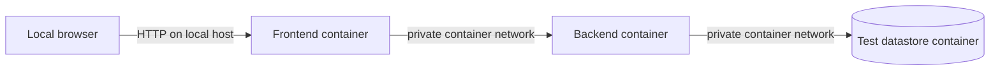
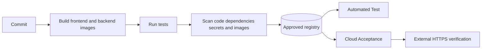
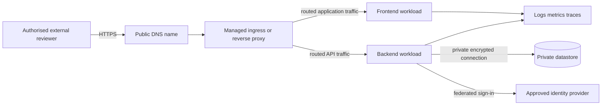

# Docker — From local test to an externally accessible cloud service

**Estimated study time:** 90 minutes plus deployment practice

## Learning objectives

After this module, you can:

- package frontend and backend as separate Docker images using Dockerfiles;
- run a repeatable local Test environment with Docker Compose networking and volumes;
- explain which configuration belongs in an image and which belongs in an environment;
- promote immutable images through a registry to a cloud runtime;
- design safe external access with DNS, HTTPS, identity, network controls, and telemetry; and
- identify portability limits, costs, and cloud cleanup responsibilities.

## Prerequisites

Complete the [implementation journey](10-implementation-journey.md) through the
first read and write slices. Docker Desktop or Docker Engine with the Compose
plugin must be available. The application must work outside containers before
you package it; Docker should not hide an unknown application failure.

## Why use Docker after the first vertical slice?

A Docker image packages an application with its runtime and dependencies.
This improves repeatability, but adds build, networking, storage, security, and
debugging concepts. Beginners first prove the frontend-backend request locally,
then package each part while preserving the same behaviour.

Use separate images because the frontend and backend have different runtime,
scaling, exposure, and security responsibilities.

## Dockerfile and image responsibilities

### Frontend image

The image contains the compiled or static frontend and a minimal web server. It
does not contain database credentials or privileged cloud credentials. Decide
whether the backend base URL is injected at runtime, discovered through a same-
origin reverse proxy, or compiled per environment. Prefer a design that lets one
tested image move between environments.

### Backend image

The image contains the API and runtime dependencies. It runs as a non-root user
where supported, writes durable state outside its writable layer, exposes only
the required port, and implements liveness or readiness endpoints with clear semantics.

### Datastore in local Test

A datastore container creates a repeatable learning environment. Use a named
volume only for intentional persistence and a migration step for schema creation.
Use synthetic seed data. In cloud, a managed datastore is often preferable for a
small team because backup, patching, and high availability are specialised work;
the application contract should permit this change without changing business logic.

## Local Docker Compose environment

A versioned `compose.yaml` should declare:

- frontend, backend, and datastore services;
- a private application network;
- only the ports required from the host;
- health checks and dependency readiness;
- named volumes for intended data;
- environment configuration and secret references; and
- resource limits where supported.

Do not place real secret values in the Compose file. A local `.env` file can be
excluded from version control, but exclusion alone is not secret management.
Provide `.env.example` with names and safe placeholders.

### Local verification sequence

1. Build images with `docker compose build` without using a developer's uncommitted dependencies.
2. Start the stack with `docker compose up -d` or the documented foreground equivalent.
3. Run migrations and synthetic seed safely.
4. Wait for readiness rather than a fixed sleep.
5. Run smoke, integration, and negative authorization tests.
6. Restart the backend and prove intentional data persists.
7. Stop the stack with `docker compose down`; remove the local test volume only
   through the documented, intentionally destructive cleanup command.

Cleanup is explicit because test data, images, networks, and volumes otherwise
accumulate and hide reproducibility problems.

## Docker security checks

Check:

- trusted and appropriately maintained base images;
- pinned or controlled dependencies;
- no secrets copied into image layers;
- non-root execution where practical;
- minimal installed packages and exposed ports;
- read-only filesystem or limited writable paths where supported;
- vulnerability and licence scan results;
- image labels or metadata linking source and version; and
- a software inventory or SBOM when required by the project.

A vulnerability scanner reports known matches. Triage reachability, severity,
available fix, and compensating controls. Record temporary exceptions with owner
and expiry.

## Build once and promote by immutable identity

The pipeline should build frontend and backend images once for a commit, run
tests and scans, and push approved images to a registry.

Use a human-readable version tag for navigation and an immutable digest for
deployment evidence. A mutable tag such as `latest` alone cannot prove what ran.

## Map local Docker services to cloud services

The cloud runtime might be a managed container application service, a container
orchestrator, or another approved platform. Preserve logical responsibilities:

| Local Test | Cloud environment |
| --- | --- |
| Frontend container | Public web workload or static frontend service |
| Backend container | Private or ingress-controlled API workload |
| Datastore container | Private managed datastore or approved stateful service |
| Local named volume | Managed durable storage or database backup policy |
| Docker Compose network | Cloud network, service discovery, and ingress rules |
| Local environment values | Environment configuration and secret references |

Portability is not perfect. Health probes, identity, storage, networking, and
autoscaling differ by platform. Isolate platform-specific configuration and
record coupling in an ADR.

## External access architecture

Authorised reviewers must reach the application from another network without
exposing internal data services.

DNS resolves the public name; it does not carry application traffic. The edge
terminates or passes through TLS according to the design. Only required ingress
is public. Administrative endpoints, registries, telemetry, and data stores use
restricted access.

## Cloud security and operations

Before external access, define:

- approved tenant, region, resource naming, tags, and owner;
- allowed user population and role mapping;
- HTTPS certificate issuance and renewal;
- public ingress paths, methods, limits, and security headers;
- private backend and datastore communication;
- workload identity or narrowly scoped cloud credentials;
- managed secrets and rotation;
- log, metric, trace, and audit destinations;
- backup and restore or reproducible rebuild;
- rate, cost, and quota alerts;
- vulnerability and deployment monitoring; and
- automatic expiration or manual cleanup date for course resources.

External access does not mean anonymous access. A login page can be public while
workplace-learning data remains protected by identity, assignment, object, and state authorization.

## Cloud pipeline gates

Before cloud deployment, require:

- passing application and authorization tests;
- passing image policy or an approved, time-limited exception;
- infrastructure and configuration review;
- no detected committed secrets;
- an immutable image digest;
- Test deployment and migration evidence;
- approval for protected environment access; and
- a rollback or forward-fix plan.

After deployment, run a smoke journey over the public HTTPS name, an unauthorized
access test, a version check, and telemetry verification. Stop or roll back when
the agreed indicators fail.

## Cost and cleanup

Cloud exercises can incur continuing cost. Use instructor-approved budgets,
quotas, small instance sizes, short log retention appropriate to the exercise,
and automatic shutdown where supported. List every created resource and its
deletion dependency. Removing the application but leaving a database, registry,
static address, or log workspace can continue to cost money.

Never delete a shared or production resource during cleanup. Resolve exact
course resource identifiers and have the owner approve the plan.

## Practice and self-check

1. Which local services need host ports, and which should remain on the private container network?
2. Why should one approved image be promoted instead of rebuilt for cloud?
3. Which settings differ between local Test and cloud Acceptance?
4. Why can the local datastore be a container while the cloud datastore is managed?
5. List five controls required before an external reviewer accesses the Workplace Learning Hub.
6. How do image digest, deployment record, and application version endpoint support traceability?
7. Which resources must be cleaned up after the course exercise?

## Summary

- Prove the application first, then package frontend and backend separately.
- Use a repeatable local Test stack with private networking, synthetic data, and explicit persistence.
- Build and scan images once; promote immutable versions through a registry.
- Cloud deployment preserves logical responsibilities while changing platform integrations.
- External access requires HTTPS, identity, restricted ingress, private data services, telemetry, and cost control.
- Cleanup and recovery are part of the architecture, not afterthoughts.

Continue with [Lab 8 — Docker local to cloud](../hands-on/08-docker-local-to-cloud.md)
and the [cloud deployment requirements](../project/cloud-deployment-requirements.md).
