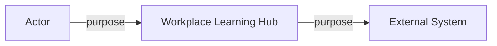

# Lab 1 — Map the system

## Goal

Translate a stakeholder description into requirements, dependencies, and a
system context. Your output will become the foundation for every later lab.

## Learning objectives

You will practise how to:

- classify functional requirements, quality attributes, constraints, and assumptions;
- turn a vague quality statement into a measurable scenario;
- identify actors, external systems, responsibilities, and failure impact; and
- create a context diagram without prematurely selecting implementation products.

## Prerequisites

- Complete [Module 1](../course/01-systems-thinking.md).
- Read the [workplace learning case](../case-study/workplace-learning-platform.md).
- Create `portfolio/01-system-map.md`.

## Scenario

The project sponsor says:

> We need one modern, secure workplace learning platform. It should be fast,
> always available, cloud native, and easy to maintain. Students must see their
> own internship dossier, logbook, documents, feedback, and progress. Academic
> supervisors and workplace mentors must see and update only assigned dossiers.
> We expect about 5,000 students, and reviews will probably peak near deadlines.

Treat this as input to analyse, not a complete specification.

## Part 1 — Classify the statements

Create a table with at least twelve statements from the case and sponsor quote.

| Statement | Type | Clarification needed |
| --- | --- | --- |
| Students log in with their school account | Functional requirement and integration constraint | Which identity protocol and account states? |
| Your statement | Functional / quality / constraint / assumption | Your question |

Include at least two items in each category. If a statement combines categories,
split it.

### Checkpoint 1

- “Cloud native” is not accepted as a measurable quality attribute without clarification.
- “Everybody will probably log in at once” is recorded as an assumption to validate.
- Security is decomposed into concrete outcomes rather than left as one word.

## Part 2 — Write quality scenarios

Write one scenario for each quality:

1. performance during an evaluation deadline;
2. authorization based on role and current dossier assignment;
3. recovery of logbooks, reviews, and document uploads; and
4. maintainability of a routine deployment.

Use this template:

| Element | Your value |
| --- | --- |
| Source | |
| Stimulus | |
| Environment | |
| Artefact | |
| Expected response | |
| Response measure | |
| Open question or assumption | |

Do not invent a final number when the stakeholder must decide it. You may write
“target to agree with product owner” and propose a candidate for discussion.

## Part 3 — Build a dependency table

Identify at least eight logical components or external systems.

| Element | Responsibility | Depends on | Failure visible to user | Likely owner |
| --- | --- | --- | --- | --- |
| Institutional IdP | Establish institutional identity | Directory and policies | Sign-in fails | Identity team |
| Your element | | | | |

Keep components logical. Do not choose a vendor service yet.

## Part 4 — Draw the system context

Create a Mermaid context diagram with:

- the Workplace Learning Hub as one system;
- students, academic supervisors, workplace mentors, and internship coordinators;
- the institutional identity provider;
- an external identity flow for workplace mentors;
- a notification provider; and
- the student information system.

Label every relationship with a purpose. Add a short paragraph defining what is
inside and outside the platform team's scope.

### Checkpoint 2

Your context view must not contain the internal API, database, pods, or subnets.
Those belong to later views. It must show direction and purpose, not only lines.

## Part 5 — Trade-off reflection

Answer in 150-250 words:

1. Which requirement is least clear and why?
2. Which external dependency creates the largest end-to-end risk?
3. Which attractive technology choice did you deliberately postpone?
4. What evidence would most change your initial design?

## Deliverables

- classification table;
- four quality scenarios;
- dependency table;
- context diagram and scope paragraph; and
- reflection.

After completing the lab, compare with the
[reference solution](solutions/01-map-the-system-solution.md).
