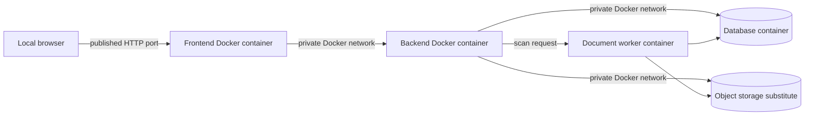

# Lab 8 — Docker from local test to cloud

## Goal

Package the workplace learning frontend and backend with Docker, run the complete
slice locally with Docker Compose, build and scan immutable images in the
pipeline, and deploy those same images to an instructor-approved cloud container
runtime for authorised external users.

## Learning objectives

You will practise how to:

- write separate Dockerfiles for frontend and backend;
- connect frontend, backend, datastore, and document services with Docker Compose;
- manage health checks, configuration, secrets, networks, and volumes;
- inspect and reduce Docker image risk;
- publish traceable image versions to a registry; and
- deploy the approved images behind a cloud HTTPS endpoint.

## Prerequisites and safety

- Complete [Docker from local test to cloud](../course/11-containers-local-to-cloud.md).
- Complete the end-project dossier-read and logbook workflow outside Docker.
- Install an instructor-supported Docker Desktop or Docker Engine with Compose.
- Use only an instructor-approved cloud account, registry, identity provider,
  region, budget, and resource scope.
- Use fictional internship data and test identities.
- Create `portfolio/08-docker-local-to-cloud.md`.

## Part 1 — Define the local Docker architecture

Draw the local runtime and list exposed ports:



Only publish ports needed from the host. The database and document store should
remain on the private Docker network unless a documented local debugging task
temporarily requires otherwise.

## Part 2 — Write the Dockerfiles

Create one Dockerfile for the frontend and one for the backend. Apply:

- an instructor-approved, maintained base image;
- a multi-stage build where it reduces the runtime image;
- a deterministic dependency restore;
- a `.dockerignore` file;
- a non-root runtime user where supported;
- only required runtime files and packages;
- an explicit application port;
- build metadata linking source revision and version; and
- no credentials, `.env` files, production configuration, or test reports in layers.

Record image sizes and explain the largest layers. Do not optimise size by
removing certificates or runtime files the application needs.

### Checkpoint 1

Run each image individually with safe local configuration. Confirm the frontend
serves a page and the backend returns a health response before introducing Compose.

## Part 3 — Build the Docker Compose Test environment

Create a versioned `compose.yaml` containing:

- frontend;
- backend;
- relational datastore;
- local object-storage or file-service substitute;
- optional document worker or safe scan simulator;
- a private application network;
- named volumes only for intentional persistence;
- health checks;
- safe environment configuration and secret references; and
- startup dependencies based on health, not a fixed sleep.

Provide `.env.example` with variable names and fictional placeholders. Keep the
real local `.env` excluded from version control.

Document commands for:

```bash
docker compose build
docker compose up -d
docker compose ps
docker compose logs --no-log-prefix backend
docker compose down
```

Document the separate command that removes test volumes. Mark it destructive and
require the learner to verify the Compose project name and volume targets first.

## Part 4 — Verify the local workflow

Run automated and manual checks:

1. student views their own fictional dossier;
2. cross-student dossier access is denied;
3. student submits a logbook entry;
4. assigned workplace mentor approves it;
5. unassigned mentor is denied;
6. student uploads a test document;
7. the document moves through scanning to accepted or rejected;
8. backend container restarts while intentional data survives; and
9. database unavailability produces a safe frontend state and useful telemetry.

Capture commands, image IDs, container health, test results, and correlation IDs.
Do not submit secret values or document contents.

## Part 5 — Inspect Docker security

Provide evidence for:

- image vulnerability and licence scan;
- dependency and secret scan;
- non-root runtime or documented exception;
- effective exposed ports;
- effective Linux capabilities or platform permissions where applicable;
- mounted files and writable paths;
- image history inspection for accidental secrets; and
- image inventory or SBOM when the selected tooling supports it.

Triage findings. Record accepted exceptions with owner, reason, compensating
control, expiry condition, and planned correction.

## Part 6 — Build once in the pipeline

Update the pipeline to:

1. test application code;
2. build frontend and backend Docker images once;
3. run image and configuration checks;
4. tag images with a readable version and source revision;
5. push approved images to the instructor-approved registry;
6. capture immutable digests; and
7. deploy by digest or equivalent immutable identity.

Do not rebuild a different image for cloud Acceptance. Protected registry and
cloud credentials must not be available to untrusted pull-request code.

## Part 7 — Map Docker Compose to cloud

Create a mapping table:

| Local Docker service | Cloud responsibility | Public or private | Configuration difference |
| --- | --- | --- | --- |
| Frontend container | | | |
| Backend container | | | |
| Database container | | | |
| Document store | | | |
| Document worker | | | |

The cloud may replace the local database container with a private managed
database and the local object store with managed object storage. The frontend
and backend must use the same approved Docker image versions built by the pipeline.

## Part 8 — Deploy for external access

Deploy to the approved cloud runtime with:

- public DNS name;
- valid HTTPS certificate without bypass warnings;
- public ingress only for the required application paths;
- private backend-management, datastore, object-storage, and telemetry access;
- approved identity flow for students, employees, and external mentors;
- cloud secret references or workload identity;
- migration job with limited permissions;
- health, readiness, logs, metrics, audit events, and version evidence;
- cost, quota, and expiry controls; and
- documented rollback or forward-fix path.

An authorised reviewer on another network must complete the student and
workplace-mentor journeys. Anonymous visitors or users without a dossier
assignment must not see internship data.

## Part 9 — Verify, recover, and clean up

Run post-deployment tests for HTTPS, identity, dossier access, logbook workflow,
document processing, authorization denial, version, and telemetry.

Perform one authorised failure exercise in Test or Acceptance. Record detection,
diagnosis, mitigation, recovery, and lessons.

List every cloud resource, registry artefact, static address, DNS record, secret,
database, storage object, telemetry workspace, and cost source. Cleanup requires
exact target verification and instructor or owner approval. Never delete a shared
or production resource.

## Completion checkpoint

- Local execution uses separate frontend and backend Docker images.
- Docker Compose starts a complete, reproducible Test stack.
- Data stores are not unnecessarily published to the host or internet.
- The pipeline builds each deployable image once and records immutable digests.
- Cloud runs the approved images rather than manually rebuilt source.
- External access uses valid HTTPS and role plus dossier-assignment authorization.
- Logs, screenshots, images, and submitted evidence contain no real personal data or secrets.
- Cost and cleanup are owned and documented.

## Deliverables

- Dockerfiles and `.dockerignore` files;
- `compose.yaml` and safe configuration example;
- local network, volume, health, and workflow evidence;
- scan findings and decisions;
- registry versions and image digests;
- local-to-cloud mapping and deployment view;
- external HTTPS, identity, and authorization evidence;
- failure and recovery timeline; and
- approved cleanup inventory.
