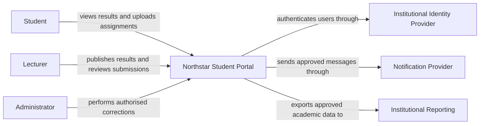

# Lab 1 solution — Map the system

## Classification examples

| Statement | Type | Clarification needed |
| --- | --- | --- |
| Students view personal results | Functional requirement | Which result states and history are visible? |
| Only the owner or authorised employee sees a result | Security quality requirement | Which delegated roles and exceptions exist? |
| Use institutional identity | Constraint | Supported protocol, claims, availability, and test tenant? |
| The portal should be fast | Quality attribute, not yet measurable | Which journey, load, percentile, and response target? |
| 5,000 students are enrolled | Scale input | Active users and growth? |
| Everybody logs in at once | Assumption | Peak rate, duration, and user behaviour? |
| Cloud native | Ambiguous preference | Which outcome is expected: elasticity, managed operation, or portability? |
| Small IT team operates the service | Constraint | Skills, support hours, and existing platforms? |

## Quality scenario example

| Element | Performance scenario |
| --- | --- |
| Source | Authenticated students |
| Stimulus | Request the results page |
| Environment | First 20 minutes after release of results |
| Artefact | Portal API and result data store |
| Response | Return only authorized result data |
| Measure | Candidate: p95 below 2 seconds at a measured peak rate, to agree with stakeholders |
| Open question | Actual arrival rate and acceptable degraded behaviour |

For recovery, a good scenario names the lost or unavailable upload, the failure
environment, restoration behaviour, RTO/RPO discussion, and evidence from a
restore exercise.

## Dependency examples

| Element | Responsibility | Depends on | Failure symptom | Owner |
| --- | --- | --- | --- | --- |
| Browser client | Present journeys and call API | Device, network, API | Page cannot complete action | Portal team |
| DNS | Resolve portal name | Resolver and authoritative records | Name cannot resolve or points incorrectly | Network team |
| Public edge | Protect and route HTTP traffic | Certificates, routes, backend health | Connection or gateway error | Platform team |
| Portal application | Rules and authorization | Identity and data services | Specific actions fail | Portal team |
| Identity provider | Institutional authentication | Directory and policy | Sign-in fails | Identity team |
| Results database | Persist academic records | Database platform | Results fail or become stale | Data/platform teams |
| Object storage | Store assignment files | Storage platform and access policy | Upload or download fails | Platform team |
| Notification provider | Deliver messages | External provider | Notifications delayed or lost | Integration owner |

## Context view

The portal team's scope includes the portal application, its data handling, and
its integrations. The identity, notification, and reporting systems are external
dependencies with separate owners. Their behaviour and service agreements still
affect the portal's end-to-end quality.
