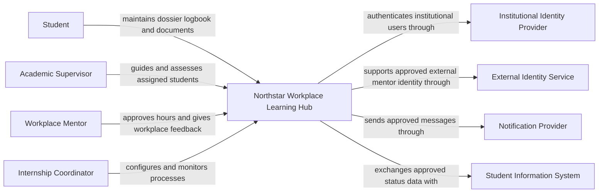

# Lab 1 solution — Map the system

## Classification examples

| Statement | Type | Clarification needed |
| --- | --- | --- |
| Students view their own internship dossier and next actions | Functional requirement | Which phases, activities, and history are visible? |
| Only assigned and authorised participants see a dossier action | Security quality requirement | Which role, assignment, state, and exceptions apply? |
| Use institutional identity | Constraint | Supported protocol, claims, availability, and test tenant? |
| The platform should be fast | Quality attribute, not yet measurable | Which journey, load, percentile, and response target? |
| 5,000 students are enrolled | Scale input | Active users and growth? |
| Everybody logs in at once | Assumption | Peak rate, duration, and user behaviour? |
| Cloud native | Ambiguous preference | Which outcome is expected: elasticity, managed operation, or portability? |
| Small IT team operates the service | Constraint | Skills, support hours, and existing platforms? |

## Quality scenario example

| Element | Performance scenario |
| --- | --- |
| Source | Authenticated academic supervisors |
| Stimulus | Request the assigned-student dashboard |
| Environment | Final evaluation deadline |
| Artefact | Workplace Learning API and dossier database |
| Response | Return only currently assigned dossiers and permitted review actions |
| Measure | Candidate: p95 below 2 seconds at a measured peak rate, to agree with stakeholders |
| Open question | Actual arrival rate and acceptable degraded behaviour |

For recovery, a good scenario names the lost or unavailable upload, the failure
environment, restoration behaviour, RTO/RPO discussion, and evidence from a
restore exercise.

## Dependency examples

| Element | Responsibility | Depends on | Failure symptom | Owner |
| --- | --- | --- | --- | --- |
| Browser client | Present journeys and call API | Device, network, API | Page cannot complete action | Application team |
| DNS | Resolve platform name | Resolver and authoritative records | Name cannot resolve or points incorrectly | Network team |
| Public edge | Protect and route HTTP traffic | Certificates, routes, backend health | Connection or gateway error | Platform team |
| Workplace Learning application | Workflow rules and authorization | Identity and data services | Specific actions fail | Platform team |
| Identity provider | Institutional authentication | Directory and policy | Sign-in fails | Identity team |
| Dossier database | Persist placement, phase, logbook, and review records | Database platform | Progress or approvals fail or become stale | Data/platform teams |
| Object storage | Store dossier documents | Storage platform, scan state, and access policy | Upload or review fails | Platform team |
| Notification provider | Deliver messages | External provider | Notifications delayed or lost | Integration owner |

## Context view

The platform team's scope includes the Workplace Learning Hub, its data handling, and
its integrations. The identity, notification, and reporting systems are external
dependencies with separate owners. Their behaviour and service agreements still
affect the platform's end-to-end quality.
