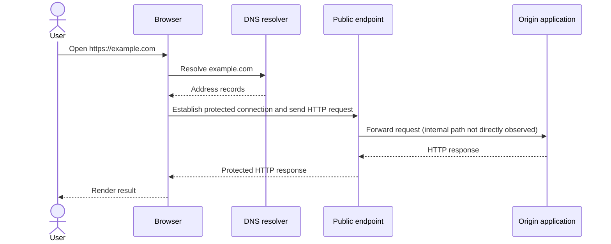

# Lab 2 solution — Trace a web request

## Evidence interpretation

Actual DNS addresses, headers, certificate chains, HTTP version, and timing can
vary. A valid solution records the learner's observation instead of copying a
fixed value.

| Observation | Supported conclusion | Not proven |
| --- | --- | --- |
| Resolver returns one or more addresses | Name resolution produced records at that time and location | The website works or every client sees the same answer |
| TLS negotiation completes for the host | The client accepted a protected session with the presented identity | The application is secure or the user is authorized |
| Main request returns HTTP 200 | That request received a successful HTTP response | Every dependency and user journey works |
| Browser creates more requests than `curl -I` | Page processing required or requested more resources | That all resources are essential or uncached |

`curl -I` asks for headers using `HEAD`; it is not identical to a browser `GET`.
Verbose output can reveal protocol and certificate details, but should be
redacted before submission.

## Sequence

The origin step is an architecture assumption unless the learner has direct
server-side evidence. DNS is a resolution exchange, not the carrier of the later
HTTP request.

## Failure hypotheses

| Hypothesis | Distinguishing test | Evidence if true |
| --- | --- | --- |
| Wrong DNS record | Compare approved resolvers and expected configuration | Unexpected address or missing record |
| Certificate invalid or wrong host | Inspect TLS error and certificate host coverage | Name, chain, or time validation failure |
| Edge cannot reach application | Compare edge status and backend health | Gateway error with failed upstream check |
| Application exception | Follow a correlation ID into application logs | Server exception for the affected route |
| Data dependency unavailable | Inspect dependency span and health from application context | Timeout or refusal after application entry |

The safe order begins with user scope and DNS, continues through connection,
TLS, and HTTP, and only then uses authorised internal telemetry.
