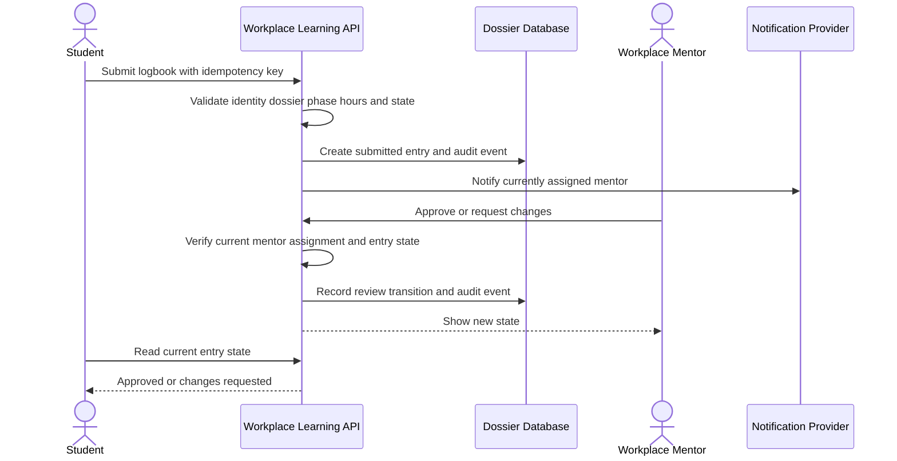
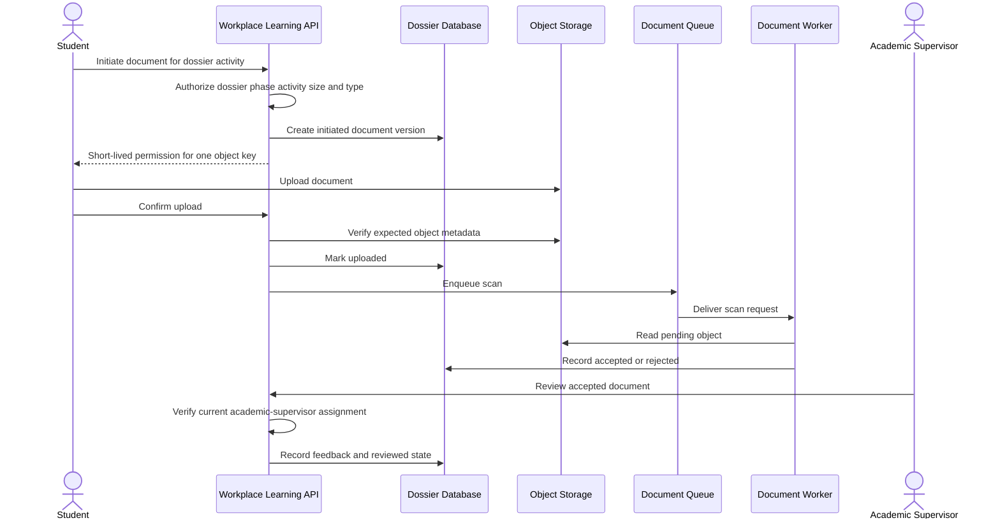

# Lab 3 solution — Model a logbook and document workflow

## Responsibilities

| Responsibility | Authoritative component |
| --- | --- |
| Display phase, progress, and state | Frontend based on API state |
| Authenticate and resolve current dossier assignment | Backend API |
| Validate logbook date, duration, phase, and transition | Backend API using database state |
| Persist dossier, logbook, feedback, and review state | Relational database |
| Store document bytes | Object storage |
| Buffer document scan work | Queue |
| Inspect content and record scan result | Document worker with constrained access |
| Record append-oriented audit evidence | Backend or trusted worker performing the action |

The browser can validate for usability, but the backend must enforce every
security-relevant rule. A role label without a current dossier assignment is insufficient.

## State transitions

### Logbook

| From | Event | Authorized actor | To |
| --- | --- | --- | --- |
| draft | Submit valid week | Student assigned to dossier | submitted |
| submitted | Approve hours | Currently assigned workplace mentor | approved |
| submitted | Request changes | Currently assigned workplace mentor | changes_requested |
| changes_requested | Resubmit corrected entry | Student assigned to dossier | submitted |

### Document

| From | Event | Authorized actor | To |
| --- | --- | --- | --- |
| none | Approved initiate request | Backend API | initiated |
| initiated | Storage confirms expected object | Trusted completion process | uploaded |
| uploaded | Scan message claimed | Document worker | scanning |
| scanning | Clean result | Document worker | accepted |
| scanning | Malware or policy rejection | Document worker | rejected |
| accepted | Reviewer opens assigned activity | Academic supervisor | under_review |
| under_review | Feedback recorded | Assigned academic supervisor | reviewed |

## Logbook sequence

If the mentor assignment changed, the former mentor is denied a new review
action. The historical submission and previous assignment evidence remain.

## Document sequence

After an uncertain timeout, the client repeats with the same idempotency key.
The API returns the existing entry or document version instead of duplicating it.

## Data placement

| Data | Authoritative store | Concern |
| --- | --- | --- |
| Dossier, placement, phase, and assignments | Relational database | transaction, assignment history, privacy |
| Logbook, hours, feedback, and review state | Relational database | workflow integrity and dispute evidence |
| Document bytes | Object storage | narrow access, quarantine, retention, version |
| Document metadata and scan state | Relational database | consistency with object lifecycle |
| Scan request | Queue | duplicate delivery and retry limit |
| Process instructions | Database or content source, optionally cached | invalidation after template update |
| Audit event | Protected append-oriented store | integrity, access, retention, minimal content |

Negative tests cover cross-dossier student access, former or unassigned mentor,
unassigned academic supervisor, expired permission, different object key, and
approval from an invalid workflow state.
