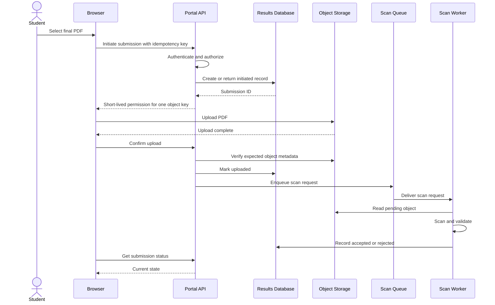

# Lab 3 solution — Model an application flow

## Responsibilities

| Responsibility | Authoritative component |
| --- | --- |
| Display progress and status | Frontend, based on API state |
| Authenticate and authorize submission | Backend API |
| Verify assignment window and one-final rule | Backend API using database state |
| Store PDF bytes | Object storage |
| Persist submission metadata and state | Relational database |
| Buffer scan work | Queue |
| Inspect content and record scan result | Scan worker, using constrained access |

The browser may validate size for usability, but the service must enforce size,
type, authorization, and state server-side.

## State transitions

| From | Event | Authorized actor | To |
| --- | --- | --- | --- |
| none | Approved initiate request | Backend API | initiated |
| initiated | Storage confirms expected object | Trusted completion process | uploaded |
| uploaded | Scan message claimed | Scan worker | scanning |
| scanning | Clean result | Scan worker | accepted |
| scanning | Malware or policy rejection | Scan worker | rejected |
| initiated | Permission expires without object | Expiry job | expired |
| scanning | Retry limit exceeded | Worker policy | review_required |

## Sequence

If the browser times out after upload, it repeats the initiate or confirmation
with the same idempotency key. The API returns the existing submission state
instead of creating a second final record.

## Data placement

| Data | Authoritative store | Concern |
| --- | --- | --- |
| Submission metadata and state | Relational database | Transaction and unique final-submission rule |
| PDF bytes | Object storage | Narrow access, retention, scan quarantine |
| Scan request | Queue | Duplicate delivery and retry limit |
| File hash | Relational metadata | Calculate from trusted processing path |
| Public instructions | Database or content source, optionally cached | Invalidation after update |
| Audit event | Protected audit store | Integrity, access, retention, no secret payload |

Negative tests attempt cross-student reads, lecturer access outside assigned
course, and reuse of an upload permission for a different object key.
