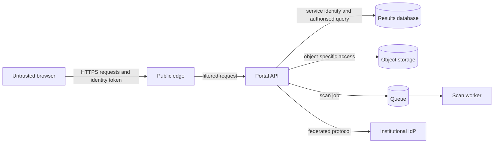

# Lab 5 solution — Threat-model the portal

## Assets and boundaries

High-value assets include academic results, assignment files, identity and
session tokens, service credentials, audit history, personal identifiers,
availability, and backup data. The main boundaries are internet-to-edge,
edge-to-application, application-to-data services, portal-to-identity provider,
and human administration.

## Example controls

| Abuse case | Prevent or limit | Detect | Recover | Verify |
| --- | --- | --- | --- | --- |
| Change result identifier | Subject-resource authorization on every endpoint | Denial count and audit event | Review session and affected routes | Two-student cross-access suite |
| Reuse upload permission | Short expiry, one object key and operation | Rejected reuse metric | Invalidate pending submission | Reuse and wrong-key tests |
| Upload active content | Size/type policy, quarantine, scanner | Rejection event and backlog metric | Delete or isolate object | Known safe test fixture |
| Forge role claim | Validate issuer, audience, signature, time, and trusted claim mapping | Token-validation failures | Revoke client/session | Invalid issuer and modified-token tests |
| Steal worker credential | Workload identity and narrow object scope | Unusual object access audit | Revoke identity and rotate access | Attempt access to result records |
| Flood result endpoint | Rate/concurrency limits and efficient query | Rate, latency, and pool metrics | Limit traffic or degrade safely | Authorised load test |
| Expose token in log | Allow-list structured fields and redaction | Automated log-content check | Restrict access and follow incident process | Representative auth-error test |
| Excess administrator privilege | Role separation and time-limited elevation | Sensitive-change audit | Remove access and reverse authorised change | Role-matrix and approval tests |

## Least privilege examples

| Identity | Required | Forbidden |
| --- | --- | --- |
| Portal runtime | Read permitted results, manage submission metadata | Schema administration and unrestricted export |
| Scan worker | Read pending objects and write scan outcome | Read academic results or issue upload permissions |
| Migration job | Apply approved schema changes | Serve user requests |
| Service desk | Read health and redacted diagnostic events | Read result content or alter records |
| Administrator | Approved academic correction workflow | Direct database-owner access for routine work |

Strong solutions also define credential lifetime, review owner, and behaviour
when authorization or identity dependencies are unavailable.
