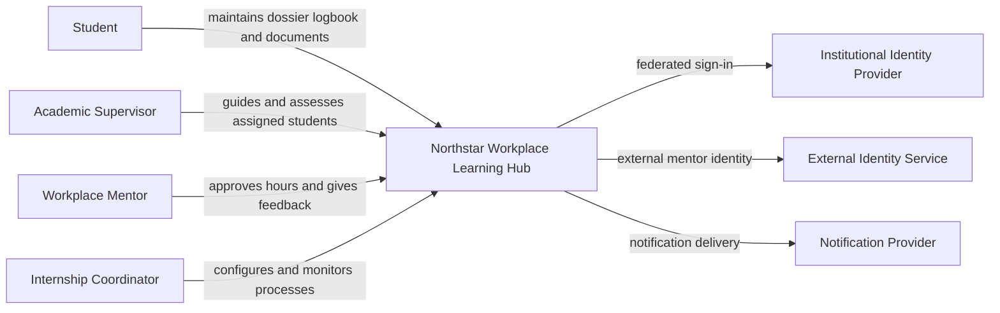
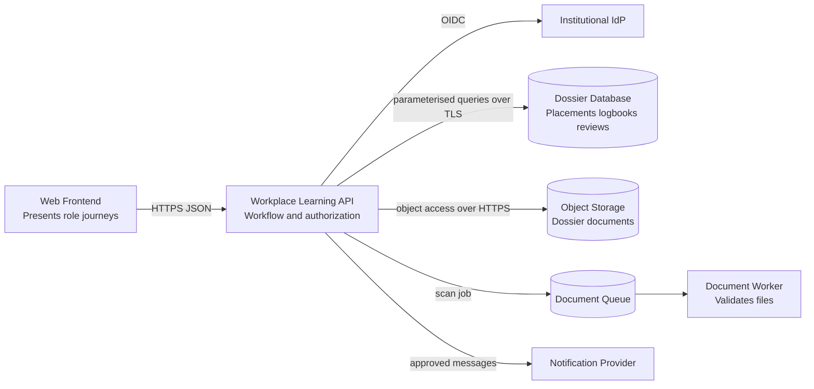

# Lab 7 solution — Create views and an ADR

## View selection

- Sponsors need the context view and quality drivers.
- Developers need the container and sequence views.
- Security reviewers need trust boundaries, data flows, and identity relationships.
- Operations engineers need production deployment, dependencies, and telemetry.
- Service desk needs user journeys, correlation flow, and safe failure mapping.

## Context view

## Container view

## ADR 001 — Use a managed application platform

### Status

Accepted for the first release.

### Context and drivers

One small team owns a moderate-scale workplace learning platform with short peaks. The institution has
no shared container platform. The service needs controlled deployment, scaling,
TLS integration, telemetry, and recovery without a new cluster operations burden.

### Options

1. Virtual machines with managed database.
2. Managed application platform with managed database.
3. New orchestrated container platform with managed database.

### Decision

Deploy the Workplace Learning API and document worker on a managed application platform.
Use managed relational data, object storage, and queue services. Keep platform-
specific configuration isolated from application rules.

### Positive consequences

- fewer OS and orchestrator responsibilities;
- straightforward deployment and scaling for the expected workload; and
- better fit with the current team.

### Negative consequences

- provider-specific deployment and identity integration;
- platform limits may constrain later requirements;
- recurring managed-service cost; and
- the team still owns application security, data, recovery policy, and incidents.

### Validation and review

Validate with a vertical slice, peak test, restore exercise, and cost review.
Revisit when platform limits block requirements, measured cost exceeds the
approved model, or the institution offers a supported shared platform.

This ADR can coexist with local container packaging: the managed platform may run
the approved application images without requiring the project to operate its own cluster.
